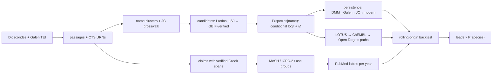

# Pharmakon

> **Research hypotheses only — not medical advice.** Pharmakon generates research hypotheses from historical texts and open databases. Nothing here is medical advice, a recommendation to use any plant, or evidence of safety or efficacy.

An uncertainty-aware, 2,000-year map of Greek and Byzantine pharmacology. Built for EthnoHack 2026, Track 1 (Traditional knowledge). The full specification is in [`spec/`](spec/README.md).

## What it does

1. **Reads the texts.** It reads Dioscorides' *De materia medica* (1st c., Wellmann) and Galen's *De simplicium medicamentorum … facultatibus*, books 6–8 (2nd c., Kühn), from First1KGreek TEI. It extracts every therapeutic claim with a **verbatim Greek evidence span** that is checked against the source passage.
2. **Identifies the plants.** For each ancient plant name it estimates **P(modern species | name)**, including an explicit *unidentified* bucket. It is evaluated against the expert gold set of Lardos et al. (2024).
3. **Traces each use through time.** Each use is followed from Dioscorides → Galen → John the Physician (13th c.) → modern Greek ethnobotany (Mount Pelion 2023, North Aegean 2018, and the Lardos references). This is tested against a permutation null.
4. **Tests prediction with a time split.** With a strict rolling-origin time split, it asks whether history predicts which plant–condition pairs later gain PubMed support, beyond research popularity.
5. **Ranks uncertainty-weighted leads.** It ranks leads weighted by identification probability, with PubMed-cited toxicity flags and Wikidata conservation status.

## Why it matters

The same three problems block every attempt to turn Greek materia medica into testable hypotheses:
- Ancient plant names do not map cleanly onto modern species.
- Persistence over time has only been studied by hand.
- Herb–disease models are almost never tested with a time split.

Pharmakon addresses all three with open data, and every number is traceable to a file in [`reports/`](reports/).

## Data (all open; details in [`docs/licences.md`](docs/licences.md))

**Texts and lexica**
- Dioscorides and Galen TEI: First1KGreek, CC BY-SA 4.0.
- LSJ: Perseus, CC BY-SA 4.0.

**Gold set and modern endpoint**
- Lardos et al. 2024 research data: figshare, CC BY 4.0.
- Two open-access Greek field studies: CC BY.

**Live services** (snapshots are cached in `data/cache/`)
- GBIF.
- Wikidata, including LOTUS: CC0.
- NLM MeSH.
- PubMed E-utilities.
- ChEMBL 37: CC BY-SA 3.0.
- Open Targets: CC0.
- PubChem.

Every source was checked live; see [`docs/source_verification.md`](docs/source_verification.md).

## Method



The pipeline is a CLI: `python -m pharmakon <stage>`. Each stage writes Parquet with provenance columns (`source_id`, `retrieved_at`, `method`) and a JSON summary in `reports/stages/`.

How the main stages work:
- **Extraction** is deterministic (`rule_extract_v1`: a Greek condition lexicon applied clause by clause). An LLM path (`--llm`, Claude, temperature 0, JSON-schema output, cached) is implemented but was not run, because this environment had no API key.
- **Identification features** contain no pharmacology:
  - GBIF occurrences in GR/CY/TR;
  - name continuity (Wikidata Greek vernacular names, Latinised epithet similarity);
  - scholarly agreement (LSJ, the Lardos literature counts);
  - genus consensus.
- **Chemistry, targets and modern studies** carry dates: LOTUS reference years, ChEMBL document years, and the publication years of the modern studies. These dates gate the backtest features.

## Results

### Identification

Leave-one-name-out over 61 expert-identified names, with 95% bootstrap CIs ([report](reports/eval_identification.md), [cards](reports/identification_cards.md)).

| model | top-1 agreement with experts | Brier | ECE |
|---|---|---|---|
| **Pharmakon (calibrated)** | **0.62** [0.51, 0.75] | **0.50** | 0.21 |
| transfer model (applied to all names) | 0.56 [0.43, 0.69] | 0.55 | 0.15 |
| LSJ dictionary baseline | 0.31 [0.20, 0.44] | 1.34 | 0.69 |
| genus-frequency prior | 0.38 [0.26, 0.51] | 0.59 | 0.09 |
| *oracle: + expert-coded traits (ablation only)* | *0.84* | *0.22* | *0.09* |

- The model beats the dictionary baseline on both top-1 and Brier.
- Removing the ethnobotanical-reference count, the one feature that overlaps the experts' use-based tie-break, leaves top-1 unchanged at 0.62, so the headline does not rest on that overlap. The transfer model uses no Lardos-derived counts at all and is the cleanest number.
- Calibration misses the ECE ≤ 0.10 target. The oracle ablation shows the missing morphology stream (which needs an LLM) is the main gap.

### Persistence

[Report](reports/eval_persistence.md).
- Of Dioscorides uses whose plant appears in the modern Greek record, **49%** recur in the same use group, against **40.5%** under a label-shuffle null (p = 0.001, 1,000 permutations).
- Galen re-attests 39% of Dioscorides uses for the 138 names that could be linked to his text, and John the Physician 36%.
- Word 4-gram containment shows Galen's text is essentially independent of Dioscorides (mean 0.002).

### Temporal backtest

The backtest finds an honest null ([report](reports/eval_forecast.md)). Cutoffs were 2000, 2005, 2010 and 2015, with 20–46 new positives per cutoff.
- Historical features alone score only slightly above random (AUROC ≈ 0.53–0.59).
- They add **no signal beyond research popularity**: the 95% CI for ΔAUPRC(history + popularity − popularity) includes 0 at every cutoff.
- Popularity (papers on the species before T) is the strongest predictor.
- Diagnosis: the history coefficients are mostly negative. The likely cause is selection. Rows are eligible only if unsupported at T, so well-attested remedies that were studied early drop out of the pool. Details are in the report.

The labels are a PubMed co-mention proxy whose precision is still awaiting a human audit.

### Uncertainty matters

[Report](reports/eval_uncertainty.md).
- Weighting leads by P(species) instead of the top-1 identity changes 6 of the top-20 leads (Kendall τ = 0.58).
- 7 of the top-20 leads rest on P(species) < 0.5.
- 5 of the top-20 carry a known-toxicity flag ([top-50 table](reports/leads_top50.md)).

## Demo

```bash
make app        # streamlit run src/pharmakon/app/Home.py
```

The app reads the committed `data/processed/`, so it needs no pipeline run. It has six pages:
- Home: headline numbers, all read from report JSON.
- Ancient Name Explorer: highlighted Greek spans, identification card with intervals, persistence timeline.
- Evidence Paths (Sankey).
- Time Machine.
- Leads, with toxicity badges and CSV export.
- Methods & Limitations.

## Reproduce

```bash
make setup                      # uv venv + install (Python 3.12)
make test                       # 24 tests: parser, extraction, model, metrics, provenance guard, app pages
make app                        # explorer on the committed outputs (no network needed)
make data verify                # raw sources + live source checks
make reproduce                  # full pipeline from scratch
```

Reproducing from scratch re-queries the live APIs. On this machine's cache the full run is minutes. From a fresh clone it takes much longer:
- PubMed alone is about 1 hour without an NCBI key.
- LSJ is streamed: about 270 MB is transient while it is parsed, then deleted.

The committed `data/processed/`, `data/gold/` and `reports/stages/` are enough for the app, the reports and the tests. The converted North Aegean table is committed in `data/external/`, so LibreOffice is only needed if that file is deleted.

Optional keys go in `.env` (see `.env.example`):
- `ANTHROPIC_API_KEY` enables the LLM extractor (`python -m pharmakon extract-claims --llm`).
- `NCBI_API_KEY` raises PubMed throughput.

## Limitations

See [`docs/limitations.md`](docs/limitations.md) and the [decision log](docs/decisions.md).
- **Expert gold, not ground truth.** The gold standard is expert judgement.
- **Unaudited labels.** The labels are a proxy, and the human audits (extraction, conditions, merges, labels) are generated in `data/gold/audits/` but **not yet completed**.
- **No LLM.** Extraction is rule-based, and the morphology feature is absent.
- **Partial chain.** Paul of Aegina is not included.
- **Current, not historical, associations.** Open Targets associations reflect today's data, so a sensitivity model without them is reported.
- **Pilot scope.** The scope is the skin/wound domain.

## Responsible research

- No dosing is displayed; quantities appear only inside quoted historical text.
- Toxic genera carry a PubChem GHS citation, resolved live.
- Modern data are used only at the aggregate species/use level from published tables.
- Folk knowledge belongs to the documented communities, so access-and-benefit-sharing (Nagoya Protocol) applies to any commercial follow-up.
- Model, prompt version and temperature are logged for any LLM output.

## How to cite / acknowledgements

Pharmakon (2026), https://github.com/LSUDOKO/Pharmakon.

Thanks to Open Greek and Latin (First1KGreek), the Perseus Digital Library, Lardos et al. (2024), Tsioutsiou et al. (2023), Axiotis et al. (2018), GBIF, Wikidata/LOTUS, NLM, EMBL-EBI ChEMBL, Open Targets and PubChem.
