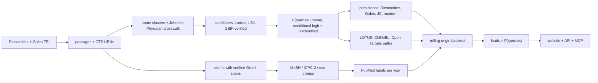

<!-- README.md is generated from docs/README.template.md by `make readme`. Edit the template, not README.md. -->

<p align="center">
  <picture>
    <source media="(prefers-color-scheme: dark)" srcset="https://pharmakon.adoranto737.workers.dev/readme/logo-dark.png?v=40da0a68d9">
    
  </picture>
</p>

<p align="center"><b>2,000 years of Greek plant medicine, measured.</b><br>
An uncertainty-aware map from Dioscorides' 1st-century Greek to modern species, chemistry and untested research leads.</p>

<p align="center">
  <a href="https://youtu.be/d-kbvFd2K04"></a>
  <a href="https://drive.google.com/file/d/1cX2WHtz4g6Yu8RxI-wfN-3ifHq9VsYnv/view?usp=sharing"></a>
  <a href="https://pharmakon.adoranto737.workers.dev"></a>
  <a href="https://pharmakon.adoranto737.workers.dev/mcp"></a>
  <br>
  <a href="https://github.com/LSUDOKO/Pharmakon/actions/workflows/ci.yml"></a>
  <a href="https://doi.org/10.5281/zenodo.24106413"></a>
  <a href="https://github.com/LSUDOKO/Pharmakon/releases/latest"></a>
  <a href="https://github.com/LSUDOKO/Pharmakon/pkgs/container/pharmakon"></a>
  
  <a href="LICENSE"></a>
  
</p>


> [!IMPORTANT]
> **Research hypotheses only, not medical advice.** Pharmakon generates research hypotheses from historical texts and open databases. Nothing here is medical advice, a recommendation to use any plant, or evidence of safety or efficacy.

## Watch the film

<table>
<tr>
<td width="58%"><a href="https://youtu.be/d-kbvFd2K04"></a></td>
<td width="42%">

**[▶ Watch the film on YouTube](https://youtu.be/d-kbvFd2K04)** (9 min)<br>
The problem, the data, the method, a live demo of the site and of the MCP server inside Claude, and every result, including the one that did not work.

**[Pitch deck](https://drive.google.com/file/d/1cX2WHtz4g6Yu8RxI-wfN-3ifHq9VsYnv/view?usp=sharing)** (Google Drive)<br>
**[Slides, PDF](docs/slides/Pharmakon_EthnoHack2026_slides.pdf)** (10 slides, built from the pipeline outputs)<br>
**[Live site](https://pharmakon.adoranto737.workers.dev)** · **[MCP endpoint](https://pharmakon.adoranto737.workers.dev/mcp)** · **[Latest release](https://github.com/LSUDOKO/Pharmakon/releases/latest)**

</td>
</tr>
</table>

## In one minute

Around 60 AD, the Greek physician **Dioscorides** wrote *De materia medica*, about 600 medicinal plants and what each one treats. Doctors copied it for 1,500 years. Three problems stop anyone turning it into testable science:

1. **Nobody is sure which plant each ancient name means.** Pharmakon gives a probability for every candidate species, with an explicit "unidentified" option. It agrees with expert botanical historians **62%** of the time; the standard Greek dictionary manages **31%**.
2. **Nobody has measured, at scale, which uses survived.** Pharmakon follows every use through Galen (2nd c.), John the Physician (13th c.) and modern Greek villages. **49%** of uses recur today, against **40.8%** expected by chance (p = 0.001).
3. **Herb–disease predictions are rarely tested honestly.** Pharmakon runs a strict time-travel test across all body systems and reports a null result: history did not predict which pairs science studied next beyond research popularity.

The output is **1781 untested plant–condition leads**, each weighted by how sure we are of the plant, with toxicity and conservation flags. Ignoring that uncertainty would change 5 of the top 20.

Use it three ways: the **[website](https://pharmakon.adoranto737.workers.dev)**, the **MCP server** for AI assistants, or the **JSON API**. All three are below.

## Project status

| part | status |
|---|---|
| Pipeline: 13 CLI stages, Parquet with provenance on every row | done |
| Identification model, persistence test, temporal backtest, leads | done, results below |
| Website with explorer, charts and leads gallery | live on Cloudflare |
| MCP server (6 read-only tools) and JSON API | live on Cloudflare |
| Streamlit research dashboard, 27 tests, CI on every push | done |
| Calibration (ECE 0.21 vs target ≤ 0.10) | **missed**, cause identified below |
| Human audits of extraction, conditions, merges, labels | **pending**: blinded sheets generated in `data/gold/audits/` |
| LLM claim extraction, LLM lexicon extension, plant-morphology feature, LLM-judge baseline | done (Claude session + Groq), every span re-verified; kept out of the backtest |
| All body systems (beyond the skin/wound pilot) | done: PubMed labels and chemistry re-run for every use group |
| Slide deck (10 slides, PDF) | done: `docs/slides/Pharmakon_EthnoHack2026_slides.pdf`, built from the pipeline outputs by `docs/slides/build_slides.py` |
| Pitch film (9 min) and pitch deck | done: [YouTube](https://youtu.be/d-kbvFd2K04) · [deck](https://drive.google.com/file/d/1cX2WHtz4g6Yu8RxI-wfN-3ifHq9VsYnv/view?usp=sharing) |


## A worked example

What the pipeline produces for one name, wormwood:

<a href="https://commons.wikimedia.org/wiki/File:Artemisia%20absinthium%20P1210748.jpg"></a>

**ἀψίνθιον** (apsinthion), *De materia medica* 3.23 · `urn:cts:greekLit:tlg0656.tlg001.1st1K-grc1:3.23.1`

> ἀψίνθιον· γνώριμος ἡ πόα. ἐστι δὲ αὐτοῦ βέλτιον τὸ ἐν Πόντῳ καὶ Καππαδοκίᾳ γεννώμενον ἐν ὄρει τῳ καλουμένῳ Ταύρῳ. δύναμιν δὲ ἔχει στυπτικήν, θερμαντικήν, ἀποκαθαρτικὴν τῶν ἐνηρεικότων στομάχῳ καὶ κοιλίᾳ χολωδῶν. ἐστι δὲ καὶ οὐρητικὸν καὶ ἀκραίπαλον προπινόμενον, καὶ πρὸς ἐμπνευματώσεις δὲ ἁρμόζει καὶ κοιλίας καὶ στομάχου ἀλγήματα πινόμενον μετὰ σεσέλεως ἢ νάρδου Κελτικῆς, καὶ ἀνορεξίας καὶ ἰκτερικούς θεραπεύει τὸ ἀπόβρεγμα αὐτοῦ ἢ τὸ ἀφέψημα καθʼ ἑκάστην ἡμέραν λαμβανόμενον εἰς πλῆθος κυάθων τριῶν.

The model's answer:

| candidate | family | P(species) | 90% interval |
|---|---|---|---|
| *Artemisia absinthium* | Asteraceae | 0.75 | 0.62–0.88 |
| (unidentified) |  | 0.23 | 0.10–0.36 |
| *Artemisia monosperma* | Asteraceae | 0.02 | 0.01–0.05 |

The uses through time:

| use | Dioscorides | Galen | John the Physician | modern Greece (expected) |
|---|---|---|---|---|
| Blood, spleen | attested | absent | — | 0.00 |
| Cardiovascular | attested | absent | — | 0.00 |
| Skin & wounds | attested | attested | — | 0.77 |
| Fever | attested | absent | — | 0.00 |
| Digestive | attested | absent | — | 0.00 |
| Gynaecology | attested | absent | — | 0.00 |
| Liver & gall | attested | absent | — | 0.00 |
| Metabolic | attested | absent | — | 0.00 |
| Eyes | attested | attested | — | 0.00 |
| Ears | attested | absent | — | 0.00 |
| Nose & throat | attested | absent | — | 0.00 |
| Urinary | attested | absent | — | 0.00 |

The highlighted evidence spans, photos and the Galen passage for this name are shown in the explorer:


<details><summary>Still image</summary>


</details>

## Results

### 1. Which plant is it?

Each of the 61 names identified by Lardos et al. (2024) is held out in turn; the model ranks GBIF-verified candidates using geography, name continuity, scholarly agreement and genus consensus, with no pharmacology at all.


| model | top-1 [95% CI] | top-3 | mean reciprocal rank | Brier ↓ | ECE ↓ |
|---|---|---|---|---|---|
| **Pharmakon (calibrated)** | 0.62 [0.51, 0.75] | 0.92 | 0.78 | 0.50 | 0.21 |
| Pharmakon, before temperature scaling | 0.62 [0.51, 0.75] | 0.92 | 0.78 | 0.50 | 0.14 |
| Transfer model (no Lardos counts; used for all names) | 0.56 [0.43, 0.69] | 0.92 | 0.74 | 0.55 | 0.15 |
| **Pharmakon + f1 morphology (LLM traits)** | 0.62 [0.51, 0.74] | 0.93 | 0.78 | 0.50 | 0.14 |
| Transfer model + f1 morphology | 0.59 [0.48, 0.72] | 0.89 | 0.74 | 0.54 | 0.16 |
| …without the ethnobotanical-reference count | 0.62 [0.51, 0.74] | 0.90 | 0.77 | 0.51 | 0.18 |
| …without geography (f2) | 0.66 [0.54, 0.79] | 0.92 | 0.79 | 0.54 | 0.24 |
| …without name continuity (f3) | 0.62 [0.51, 0.75] | 0.92 | 0.78 | 0.49 | 0.18 |
| …without scholarly agreement (f4) | 0.54 [0.41, 0.67] | 0.90 | 0.72 | 0.55 | 0.14 |
| …without genus consensus (f6) | 0.66 [0.54, 0.79] | 0.92 | 0.80 | 0.49 | 0.20 |
| LSJ dictionary baseline | 0.31 [0.20, 0.44] | 0.80 | 0.57 | 1.34 | 0.69 |
| Genus-frequency prior | 0.38 [0.26, 0.51] | 0.87 | 0.62 | 0.59 | 0.09 |
| Uniform guess | 0.39 [0.28, 0.52] | 0.87 | 0.63 | 0.63 | 0.12 |
| LLM judge (Claude session, Greek text + candidate list; comparison only, may have memorised) | 0.59 [0.46, 0.71] | 0.89 | 0.75 | 0.55 | 0.10 |
| *Oracle: + expert-coded traits (ablation only)* | 0.84 [0.74, 0.92] | 0.98 | 0.91 | 0.22 | 0.09 |

- The model beats the dictionary baseline on top-1 and on Brier score.
- Removing the one feature that overlaps the experts' own tie-break (the ethnobotanical-reference count) leaves top-1 unchanged, so the headline does not rest on it. The transfer model uses no Lardos-derived counts and is the cleanest number.

What the model learned (conditional-logit weights; the "unidentified" option has its own utility):

| feature | what it measures | weight (full) | weight (transfer) |
|---|---|---|---|
| `f2_geo_log_occ` | log(1 + GBIF occurrences in GR+CY+TR) | +0.22 | +0.38 |
| `f2_present_gr` | ≥1 GBIF occurrence in Greece | +0.69 | +0.68 |
| `f3_vernacular_sim` | max similarity of ancient name to modern Greek vernacular names (Wikidata P1843@el) | +0.03 | +0.02 |
| `f3_epithet_sim` | max similarity of Latinised ancient name to genus / epithet | +0.08 | +0.23 |
| `f4_lit_dmm` | log(1 + # botanical-history references proposing the taxon) [Lardos file 5] | +0.47 |  |
| `f4_lit_ethno` | log(1 + # ethnobotanical references linking the name to the taxon) [Lardos file 5] | +0.35 |  |
| `f4_lsj` | LSJ gives the binomial (1 asserted, 0.5 hedged) | -0.29 | -0.31 |
| `f6_genus_consensus` | share of the unit's candidates in the same genus | +0.18 | +0.15 |
| `f1_morph` | morphological agreement: Dioscorides' description vs the species' Wikipedia description (LLM-extracted traits, spans verified) | +0.18 | +0.25 |


### 2. Did the uses survive?


- Galen re-attests **37%** of Dioscorides' uses for the names that could be linked to his text, John the Physician **34%**.
- Galen is not copying: mean word 4-gram containment against Dioscorides is close to zero.

Survival by body system (Dioscorides uses whose plant could be identified):

| use group | persisted to modern Greece | to Galen only | to John the Physician only | modified | lost |
|---|---|---|---|---|---|
| Skin & wounds | 74 | 51 | 0 | 13 | 77 |
| Digestive | 34 | 9 | 1 | 19 | 60 |
| Gynaecology | 16 | 12 | 0 | 42 | 52 |
| Urinary | 25 | 11 | 2 | 20 | 40 |
| Muscles & joints | 15 | 7 | 0 | 20 | 41 |
| Respiratory | 22 | 7 | 2 | 10 | 33 |
| Fever | 7 | 3 | 0 | 19 | 36 |
| Eyes | 5 | 3 | 1 | 25 | 25 |
| Liver & gall | 12 | 4 | 0 | 11 | 18 |
| Mouth & teeth | 6 | 5 | 2 | 16 | 13 |
| Pregnancy & birth | 5 | 6 | 1 | 10 | 19 |
| Blood, spleen | 4 | 6 | 0 | 10 | 18 |
| Cardiovascular | 6 | 0 | 0 | 7 | 19 |
| Neurological | 6 | 2 | 0 | 7 | 15 |
| Other | 5 | 1 | 0 | 10 | 14 |
| Ears | 4 | 2 | 0 | 13 | 8 |
| Nose & throat | 1 | 1 | 0 | 4 | 6 |
| Infections | 0 | 0 | 0 | 4 | 4 |
| Metabolic | 0 | 0 | 0 | 1 | 1 |


### 3. The time machine

Stand in 2000, 2005, 2010 or 2015, forget everything published after, rank the plant–condition pairs nobody had studied yet, then check PubMed up to 2025. Features are gated by date: compound reference years, ChEMBL document years and modern-study publication years must all precede the cutoff, and no LLM output is used.


| cutoff | test pairs | gained support by 2025 | Random | Popularity | History | History + popularity | Everything | Δ history [95% CI] |
|---|---|---|---|---|---|---|---|---|
| 2000 | 1404 | 122 | 0.08 | 0.38 [0.31, 0.47] | 0.13 [0.09, 0.18] | 0.36 [0.29, 0.46] | 0.35 [0.28, 0.44] | -0.08 to +0.03 |
| 2005 | 1384 | 102 | 0.08 | 0.34 [0.28, 0.45] | 0.08 [0.06, 0.12] | 0.27 [0.22, 0.36] | 0.22 [0.16, 0.30] | -0.14 to -0.02 |
| 2010 | 1361 | 79 | 0.06 | 0.31 [0.24, 0.42] | 0.07 [0.05, 0.10] | 0.29 [0.22, 0.42] | 0.30 [0.22, 0.42] | -0.08 to +0.06 |
| 2015 | 1332 | 50 | 0.04 | 0.27 [0.18, 0.42] | 0.06 [0.03, 0.11] | 0.28 [0.19, 0.40] | 0.28 [0.19, 0.40] | -0.05 to +0.06 |

The same test on the skin/wound pilot and on all body systems (more positives per cutoff):

| scope | cutoff | test pairs | gained support | AUPRC popularity | AUPRC history + popularity | Δ history [95% CI] |
|---|---|---|---|---|---|---|
| skin/wound pilot | 2000 | 392 | 46 | 0.17 | 0.16 | -0.07 to +0.04 |
| skin/wound pilot | 2005 | 385 | 39 | 0.38 | 0.34 | -0.14 to +0.07 |
| skin/wound pilot | 2010 | 373 | 27 | 0.56 | 0.55 | -0.06 to +0.06 |
| skin/wound pilot | 2015 | 366 | 20 | 0.50 | 0.46 | -0.13 to +0.05 |
| all body systems | 2000 | 1404 | 122 | 0.38 | 0.36 | -0.08 to +0.03 |
| all body systems | 2005 | 1384 | 102 | 0.34 | 0.27 | -0.14 to -0.02 |
| all body systems | 2010 | 1361 | 79 | 0.31 | 0.29 | -0.08 to +0.06 |
| all body systems | 2015 | 1332 | 50 | 0.27 | 0.28 | -0.05 to +0.06 |

**Finding: a null.** Historical features alone score close to random, and adding them to research popularity never moves AUPRC beyond its confidence interval. The history coefficients are mostly negative, which points to selection: a pair is eligible only while unstudied, so well-attested remedies that science studied early drop out of the pool. Labels are a PubMed co-mention proxy awaiting a human audit.

### 4. What the LLM layer added

Two LLMs were used, and neither is ever the final authority. A Claude session (claude-opus-5-5) read all Greek passages twice (once for therapeutic claims, once for the plant's described form), turned most modern Wikipedia descriptions into the same trait vocabulary, and played the LLM-judge baseline without access to the expert answers. Groq's `openai/gpt-oss-120b` (temperature 0, cached API calls) extracted traits for the first 121 species until its daily token budget ran out. Every LLM output carries a verbatim span that the pipeline re-checks against the source; claims reach MeSH only through the verified lexicon; and **nothing LLM-derived enters the temporal backtest**, which keeps the deterministic claims and the frozen non-LLM identification.

| LLM step | result |
|---|---|
| Passages read by the LLM (Claude session) | 1,158 |
| Claims the LLM extracted | 5,075 |
| …with verbatim Greek spans that passed the substring check | 100% |
| Rule-extracted uses the LLM also found | 94.9% |
| 'Ambiguous' rule claims the LLM confirmed as uses | 468 of 614 |
| LLM claims outside the lexicon (kept apart, proposals for the lexicon) | 1,616 |
| Usable (`ok`) claims before → after | 2561 → 3,550 |
| Dioscorides chapters with an LLM trait record (spans verified) | 324 |
| Candidate species with a Wikipedia description / with traits | 382 / 350 of 485 |
| Candidate rows with ≥1 comparable trait (mean traits compared) | 495 of 839 (2.51) |

The morphology feature (f1) compares what Dioscorides says a plant looks like with what a modern description says, trait by trait (habit, height, leaf form, flower colour, fruit, root, smell, taste, habitat …). Its effect on identification is in the first table above (rows marked f1).

### 5. Leads for the lab

Plant–condition pairs used historically, with **no matching PubMed pharmacology paper yet**, ranked by forecast score × P(species). The top 20:

> [!WARNING]
> Hypotheses to test, never advice to use. Rows marked ⚠ contain a compound with a PubChem GHS hazard record.


<table>
<tr><td width="25%" align="center"><a href="https://commons.wikimedia.org/wiki/File:Illustration%20Vicia%20faba1.jpg"></a><br><sub><b>#1</b> <i>Vicia faba</i><br>Eye Diseases · P = 0.66<br>Photo: Wikimedia Commons contributor, Public domain</sub></td><td width="25%" align="center"><a href="https://commons.wikimedia.org/wiki/File:Fennel%20%28Foeniculum%20vulgare%29%20-%20Parc%20Natural%20de%20s%27Albufera%2C%20Spain%202022-04-18%20%2802%29.jpg"></a><br><sub><b>#3</b> <i>Foeniculum vulgare</i><br>Kidney Diseases · P = 0.58<br>Photo: Ryan Hodnett, CC BY-SA 4.0</sub></td><td width="25%" align="center"><a href="https://commons.wikimedia.org/wiki/File:Artemisia%20absinthium%20P1210748.jpg"></a><br><sub><b>#4</b> <i>Artemisia absinthium</i> ⚠<br>Eye Diseases · P = 0.75<br>Photo: David Monniaux, CC BY-SA 3.0</sub></td><td width="25%" align="center"><a href="https://commons.wikimedia.org/wiki/File:Cypr%C3%A8s.jpg"></a><br><sub><b>#5</b> <i>Cupressus sempervirens</i><br>Wounds and Injuries · P = 0.66<br>Photo: Taoujouti Abdelmouhaïmen, CC BY-SA 4.0</sub></td></tr>
<tr><td width="25%" align="center"><a href="https://commons.wikimedia.org/wiki/File:Ruta%20graveolens%20-%20K%C3%B6hler%E2%80%93s%20Medizinal-Pflanzen-259.jpg"></a><br><sub><b>#7</b> <i>Ruta graveolens</i> ⚠<br>Eye Diseases · P = 0.52<br>Photo: Franz Eugen Köhler, Köhler&#x27;s Medizinal-Pflanzen, Public domain</sub></td><td width="25%" align="center"><a href="https://commons.wikimedia.org/wiki/File:Punica%20granatum%20004.JPG"></a><br><sub><b>#8</b> <i>Punica granatum</i><br>Hernia · P = 0.73<br>Photo: H. Zell, CC BY-SA 3.0</sub></td><td width="25%" align="center"><a href="https://commons.wikimedia.org/wiki/File:Illustration%20Myrtus%20communis0.jpg"></a><br><sub><b>#9</b> <i>Myrtus communis</i><br>Eye Diseases · P = 0.46<br>Photo: Wikimedia Commons contributor, Public domain</sub></td><td width="25%" align="center"><a href="https://commons.wikimedia.org/wiki/File:Isatis%20tinctoria02.JPG"></a><br><sub><b>#10</b> <i>Isatis tinctoria</i><br>Wounds and Injuries · P = 0.65<br>Photo: Wikimedia Commons contributor, CC BY-SA 3.0</sub></td></tr>
<tr><td width="25%" align="center"><a href="https://commons.wikimedia.org/wiki/File:20121002Hedera%20helix1.jpg"></a><br><sub><b>#11</b> <i>Hedera helix</i> ⚠<br>Pain · P = 0.65<br>Photo: AnRo0002, CC0</sub></td><td width="25%" align="center"><a href="https://commons.wikimedia.org/wiki/File:%28MHNT%29%20Raphanus%20raphanistrum%20-%20flowers.jpg"></a><br><sub><b>#12</b> <i>Raphanus raphanistrum</i><br>Wounds and Injuries · P = 0.59<br>Photo: Didier Descouens, CC BY-SA 4.0</sub></td><td width="25%" align="center"><a href="https://commons.wikimedia.org/wiki/File:Frouzet%20fg02.jpg"></a><br><sub><b>#13</b> <i>Quercus ilex</i><br>Inflammation · P = 0.67<br>Photo: Fritz Geller-Grimm, CC BY-SA 3.0</sub></td><td width="25%" align="center"><a href="https://commons.wikimedia.org/wiki/File:Vitex%20agnus-castus%20%2815390963576%29.jpg"></a><br><sub><b>#14</b> <i>Vitex agnus-castus</i><br>Inflammation · P = 0.64<br>Photo: peganum from Henfield, England, CC BY-SA 2.0</sub></td></tr>
</table>

<sub>One photo per species, best-ranked lead first: Wikimedia Commons image (Wikidata P18; each file under its own licence, click for the file page). ⚠ = known toxic constituent.</sub>

| # | species | condition (MeSH) | P(species) | lead score | toxicity | IUCN | used in modern Greece | rank if certainty ignored |
|---|---|---|---|---|---|---|---|---|
| 1 | *Vicia faba* | Eye Diseases | 0.66 | 0.387 |  |  |  | 1 |
| 2 | *Vicia faba* | Hemorrhage | 0.66 | 0.361 |  |  |  | 2 |
| 3 | *Foeniculum vulgare* | Kidney Diseases | 0.58 | 0.290 |  |  | yes | 4 |
| 4 | *Artemisia absinthium* | Eye Diseases | 0.75 | 0.276 | ⚠ known toxic constituent ([PubChem](https://pubchem.ncbi.nlm.nih.gov/compound/261491)) |  |  | 11 |
| 5 | *Cupressus sempervirens* | Wounds and Injuries | 0.66 | 0.244 |  | least concern | yes | 12 |
| 6 | *Artemisia absinthium* | Pain | 0.75 | 0.242 | ⚠ known toxic constituent ([PubChem](https://pubchem.ncbi.nlm.nih.gov/compound/261491)) |  |  | 18 |
| 7 | *Ruta graveolens* | Eye Diseases | 0.52 | 0.228 | ⚠ known toxic constituent ([PubChem](https://pubchem.ncbi.nlm.nih.gov/compound/2355)) |  |  | 7 |
| 8 | *Punica granatum* | Hernia | 0.73 | 0.226 |  | least concern |  | 21 |
| 9 | *Myrtus communis* | Eye Diseases | 0.46 | 0.224 |  | least concern |  | 5 |
| 10 | *Isatis tinctoria* | Wounds and Injuries | 0.65 | 0.218 |  |  |  | 16 |
| 11 | *Hedera helix* | Pain | 0.65 | 0.217 | ⚠ known toxic constituent ([PubChem](https://pubchem.ncbi.nlm.nih.gov/compound/73296)) |  |  | 17 |
| 12 | *Raphanus raphanistrum* | Wounds and Injuries | 0.59 | 0.211 |  |  |  | 13 |
| 13 | *Quercus ilex* | Inflammation | 0.67 | 0.209 |  | least concern | yes | 20 |
| 14 | *Vitex agnus-castus* | Inflammation | 0.64 | 0.203 |  | Data Deficient |  | 19 |
| 15 | *Senecio vulgaris* | Wounds and Injuries | 0.69 | 0.192 | ⚠ known toxic constituent ([PubChem](https://pubchem.ncbi.nlm.nih.gov/compound/5281743)) |  |  | 30 |
| 16 | *Vicia faba* | Diarrhea | 0.66 | 0.188 |  |  |  | 28 |
| 17 | *Lupinus albus* | Stomach Diseases | 0.54 | 0.183 | ⚠ known toxic constituent ([PubChem](https://pubchem.ncbi.nlm.nih.gov/compound/72325)) | least concern |  | 15 |
| 18 | *Ruta graveolens* | Hemorrhage | 0.52 | 0.179 | ⚠ known toxic constituent ([PubChem](https://pubchem.ncbi.nlm.nih.gov/compound/2355)) |  |  | 14 |
| 19 | *Lolium perenne* | Liver Diseases | 0.31 | 0.178 |  |  |  | 1127 |
| 20 | *Cupressus sempervirens* | Inflammation | 0.66 | 0.173 |  | least concern | yes | 34 |

- **2** of the top 20 rest on a plant identification below 0.5.
- **7** of the top 20 carry a known-toxicity flag.
- Ranking by the single most likely plant instead of the full probability changes 5 of the top 20 (Kendall τ = 0.50).

Leads by condition:

| condition | leads | best lead | its P(species) | flagged toxic |
|---|---|---|---|---|
| Menstruation Disturbances | 93 | *Daucus carota* (#81) | 0.54 | 18 |
| Skin Ulcer | 80 | *Daucus carota* (#42) | 0.54 | 12 |
| Bites and Stings | 66 | *Vicia faba* (#50) | 0.66 | 7 |
| Edema | 60 | *Daucus carota* (#47) | 0.54 | 6 |
| Uterine Diseases | 55 | *Hedera helix* (#33) | 0.65 | 12 |
| Dysuria | 55 | *Vitis vinifera* (#614) | 0.43 | 3 |
| Inflammation | 42 | *Quercus ilex* (#13) | 0.67 | 9 |
| Jaundice | 42 | *Cicer arietinum* (#167) | 0.69 | 3 |
| Eye Diseases | 41 | *Vicia faba* (#1) | 0.66 | 14 |
| Colic | 41 | *Daucus carota* (#312) | 0.45 | 1 |
| Cough | 40 | *Vicia faba* (#64) | 0.66 | 6 |
| Splenic Diseases | 40 | *Lupinus albus* (#186) | 0.54 | 10 |


## Use it

### From an AI assistant (MCP)

The MCP server runs on the same Cloudflare Worker as the site. It is read-only, needs no key, and every reply carries the research-only notice and toxicity flags.


**Claude Code**

```bash
claude mcp add --transport http pharmakon https://pharmakon.adoranto737.workers.dev/mcp
```

**Claude Desktop / claude.ai:** Settings → Connectors → *Add custom connector* → `https://pharmakon.adoranto737.workers.dev/mcp`

**Cursor, Windsurf, VS Code and other clients** (`mcp.json`):

```json
{
  "mcpServers": {
    "pharmakon": { "url": "https://pharmakon.adoranto737.workers.dev/mcp" }
  }
}
```

Clients that only speak stdio can bridge with `npx mcp-remote https://pharmakon.adoranto737.workers.dev/mcp`.

| tool | what it returns |
|---|---|
| `search_ancient_names` | Search the ~650 plant and drug names in Dioscorides' De materia medica (1st c.) by Greek (accents optional), transliteration, or modern Latin species. Returns ids for get_ancient_name. |
| `get_ancient_name` | Full record for one ancient name: Greek passages with CTS URNs and verbatim evidence spans, extracted uses, P(species | name) with 90% intervals, the use's survival through Galen, John the Physician (13th c.) and modern Greece, and modern Greek folk uses. |
| `list_leads` | Ranked research leads: plant–condition pairs used historically, with no matching PubMed pharmacology paper yet, weighted by identification certainty. Always check known_toxicity. |
| `get_lead` | One lead by rank with its compound → human target → disease evidence paths (LOTUS, ChEMBL, Open Targets) and the exact PubMed query behind its 'unstudied' label. |
| `list_conditions` | Conditions that have leads, with counts. Use the names as list_leads condition filters. |
| `get_results` | Evaluation results with confidence intervals: overview, identification (vs expert gold), persistence (vs permutation null), forecast (rolling-origin backtest), leads, labels, extraction, texts, chemistry, galen, graph. |

Things to ask:

- *"Which ancient Greek plants were used for burns, and how sure are we of each identification?"*
- *"Show the evidence for lead #2 and the PubMed query behind it."*
- *"Did Galen agree with Dioscorides about wormwood?"*
- *"How well did the backtest do in 2010?"*

### From code (JSON API)

Plain HTTPS GET, no key, CORS open. Same data and disclaimer as the MCP tools.

| endpoint | returns |
|---|---|
| `GET /api/names?q=&filter=&limit=` | ancient names matching Greek, transliteration or Latin species |
| `GET /api/names/{id}` | one name: passages, uses, identification, survival, Galen, modern uses |
| `GET /api/leads?condition=&species=&min_p=&hide_toxic=&limit=&offset=` | ranked leads |
| `GET /api/leads/{rank}` | one lead with compound → target → disease paths |
| `GET /api/conditions` | conditions with lead counts |
| `GET /api/results?section=` | evaluation results (`overview`, `identification`, `persistence`, `forecast`, …) |

```bash
curl "https://pharmakon.adoranto737.workers.dev/api/leads?condition=burn&hide_toxic=true&limit=3"
```

```python
import requests
r = requests.get("https://pharmakon.adoranto737.workers.dev/api/names", params={"q": "Artemisia"}).json()
for n in r["results"]:
    print(n["lemma"], n["top_species"], n["p_top"])
```


### On the website

<table>
<tr>
<td width="50%"><br><b>The problem in one word.</b> One Greek name, several candidate plants, each with a probability.</td>
<td width="50%"><br><b>How it works.</b> Read, extract, identify, trace, test, rank.</td>
</tr>
<tr>
<td width="50%"><br><b>What the evidence says.</b> Both tests, reported the same way whether they worked or not.</td>
<td width="50%"><br><b>Open data.</b> Every source checked live, licences recorded, limits stated.</td>
</tr>
</table>

### Run it yourself

```bash
git clone https://github.com/LSUDOKO/Pharmakon && cd Pharmakon
make setup      # uv venv + install (Python 3.12)
make test       # 27 tests: parser, extraction, model, metrics, provenance guard, app pages
make app        # Streamlit research dashboard on the committed tables (no network)
make data verify   # download raw sources, check every API live
make reproduce     # the full pipeline from scratch
make readme        # regenerate this README's charts and tables
```

Or pull the container (CLI and committed tables, no network needed for the dashboard):

```bash
docker run --rm ghcr.io/lsudoko/pharmakon:latest --help
docker run --rm -p 8501:8501 --entrypoint streamlit ghcr.io/lsudoko/pharmakon:latest run src/pharmakon/app/Home.py --server.address=0.0.0.0
```

From a fresh clone, PubMed takes about an hour without an NCBI key. Optional keys go in `.env`: `ANTHROPIC_API_KEY` (LLM extraction), `NCBI_API_KEY`, `IUCN_TOKEN`.

Rebuild and deploy the site, API and MCP server (from `web/`): `npm install && npm run data && npm run deploy`.

## Method




| stage | command | output |
|---|---|---|
| Read texts | `python -m pharmakon ingest-texts` | 1,500 passages, 835 chapters, headwords parsed 97.6% |
| Extract uses | `python -m pharmakon extract-claims` | 3,696 claims, 0 span mismatches, extractor `rule_extract_v1` |
| Map conditions | `python -m pharmakon map-conditions` | 158 Greek conditions, 134 with verified MeSH, 24 with no modern equivalent |
| Expert gold | `python -m pharmakon gold` | 61 Dioscorides names, 50 John the Physician lemmas |
| Identify plants | `python -m pharmakon identify` | 839 candidates, 537 of 683 names verified in GBIF |
| Read Galen | `python -m pharmakon ingest-galen` | 476 drug entries, 1033 claims, copy containment 0.002 |
| Link chemistry | `python -m pharmakon link-chemistry` | 10,252 compounds, 455 human targets, 4,880 closed paths |
| Trace persistence | `python -m pharmakon persistence` | 1,533 name × use rows, 1,226 modern records |
| Label evidence | `python -m pharmakon evidence-labels` | 1999 plant–condition pairs, 218 with PubMed support by 2025 |
| Backtest | `python -m pharmakon forecast` | cutoffs 2000, 2005, 2010, 2015 |
| Rank leads | `python -m pharmakon leads` | 1781 untested pairs, Kendall τ 0.50 vs top-1 identity |
| Knowledge graph | `python -m pharmakon build-kg` | 2,585 nodes, 9,146 edges |

Rules the pipeline enforces:

- **Verbatim evidence.** Every extracted claim stores the exact Greek substring and its CTS URN; a Unicode-normalised substring check archives any mismatch instead of keeping it.
- **Provenance everywhere.** Every row carries `source_id`, `retrieved_at` and `method`; a test fails the build if a table lacks them.
- **Generate, then verify.** Species names are verified against GBIF, diseases against MeSH, compounds by InChIKey. Unverifiable candidates are dropped and counted.
- **No leakage.** Backtest features use only information dated on or before the cutoff; LLM outputs are never used as a score.

## Data and licences

| data | source | licence |
|---|---|---|
| Dioscorides, *De materia medica* (Wellmann), TEI | First1KGreek / Open Greek and Latin | CC BY-SA 4.0 |
| Galen, *De simpl. med. temp. ac fac.* books 6–8 (Kühn), TEI | First1KGreek | CC BY-SA 4.0 |
| Liddell–Scott–Jones Greek lexicon | Perseus Digital Library | CC BY-SA 4.0 |
| Expert identifications, John the Physician crosswalk | Lardos et al. 2024, figshare | CC BY 4.0 |
| Mount Pelion ethnobotany | Tsioutsiou et al. 2023 | CC BY |
| North Aegean ethnobotany | Axiotis et al. 2018 | CC BY |
| Taxonomy and Greek/Cypriot/Turkish occurrences | GBIF backbone + occurrence API | CC0 / CC BY |
| Vernacular names, conservation status, plant photos | Wikidata / Wikimedia Commons | CC0 / per file |
| Plant → compound occurrences | LOTUS via Wikidata | CC0 |
| Compound → target activity | ChEMBL 37 | CC BY-SA 3.0 |
| Target → disease association | Open Targets Platform | CC0 |
| Disease vocabulary | NLM MeSH | public domain |
| Evidence labels (co-mention) | PubMed E-utilities | NLM terms |
| Species descriptions for the morphology feature | English Wikipedia (MediaWiki API) | CC BY-SA 4.0 |
| Toxicity citations (GHS) | PubChem | public domain |

Every source was checked live before use; the checks are recorded in `docs/source_verification.md`. Modern translations under copyright (Beck, Osbaldeston) are not used.

## Research roadmap

What would make the results stronger, in order of value per effort:

| next step | what it fixes | needs |
|---|---|---|
| Fill the four blinded audit sheets (now also covering LLM claims and the LLM lexicon extension) | turns proxy precision into audited numbers | expert reviewer time |
| Richer modern descriptions (Flora of Greece, POWO with permission) | f1 compares only ~3 traits per candidate today | data access |
| Historical Open Targets snapshots | removes the last time-leak in the chemistry features | archived releases |
| Paul of Aegina (7th c.), Oribasius, Aetius | completes the Byzantine chain | no open TEI exists yet; OCR of the CMG editions |
| Arabic and Latin transmission (Ibn al-Bayṭār, Latin Dioscorides) | follows the remedies out of the Greek world | new corpora and lexica |
| Zenodo release with DOI | citable, versioned dataset | release step |
| Screening partnership for top non-toxic leads | the only real test of a lead | a pharmacognosy lab |

## Limitations

- **Expert gold, not ground truth.** The gold standard is the judgement of Lardos et al.; intervals are wide with 61 names.
- **Proxy labels.** "Supported" means a PubMed co-mention with a pharmacology filter, not a validated finding. Its precision is not yet audited.
- **LLM outputs.** Claims and Greek trait records come from a Claude session and are committed rather than regenerated; species traits come from Groq. All spans are verified, but no human has audited them yet, and the LLM-proposed lexicon stems await the condition-mapping audit.
- **Scope.** Results cover all body systems; the original skin/wound pilot is kept for comparison. The Mount Pelion study covers skin ailments only, which favours skin uses in the persistence test.
- **Text chain.** Paul of Aegina is missing; John the Physician is reached only through the 50 plants Lardos et al. analysed; 137 of 476 Galen entries are unmapped.
- **Chemistry.** LOTUS via Wikidata, capped at 15 compounds per taxon and 120 taxa; human single-protein targets only; Open Targets associations are current, so a sensitivity model without them is reported.
- **Conservation status** comes from Wikidata P141, not the IUCN API.

## Responsible research

- No dosing is displayed; quantities appear only inside quoted historical text.
- Toxic genera carry a PubChem GHS citation resolved live; every API and MCP reply repeats the disclaimer.
- Modern ethnobotanical data are used only at the aggregate species and use level from published tables.
- Folk knowledge belongs to the documented communities: access-and-benefit-sharing under the Nagoya Protocol applies to any commercial follow-up.

## Cite and acknowledge

Arpit (2026). *Pharmakon: an uncertainty-aware, 2,000-year map of Greek and Byzantine pharmacology* (software). Zenodo. https://doi.org/10.5281/zenodo.24106413

The DOI above always resolves to the latest version; v1.0.1 specifically is [10.5281/zenodo.24106414](https://doi.org/10.5281/zenodo.24106414). Citation metadata: [`CITATION.cff`](CITATION.cff) (GitHub's "Cite this repository" button).

Built by **Arpit** (B.Tech Computer Science, NIT Hamirpur).

Built for EthnoHack 2026, Track 1 (Traditional knowledge). Thanks to Open Greek and Latin (First1KGreek), the Perseus Digital Library, Lardos et al. (2024), Tsioutsiou et al. (2023), Axiotis et al. (2018), GBIF, Wikidata and LOTUS, NLM, EMBL-EBI ChEMBL, Open Targets and PubChem. Manuscript images: Vienna Dioscorides (Codex Vindobonensis med. gr. 1), public domain.

Code: MIT. Data: under each source's licence, listed above.
