<!-- README.md is generated from docs/README.template.md by `make readme`. Edit the template, not README.md. -->

<p align="center">
  <picture>
    <source media="(prefers-color-scheme: dark)" srcset="docs/media/logo-dark.png">
    
  </picture>
</p>

<p align="center"><b>2,000 years of Greek plant medicine, measured.</b><br>
An uncertainty-aware map from Dioscorides' 1st-century Greek to modern species, chemistry and untested research leads.</p>

<p align="center">
  <a href="https://pharmakon.adoranto737.workers.dev"></a>
  <a href="https://pharmakon.adoranto737.workers.dev/mcp"></a>
  
  
  
  
</p>

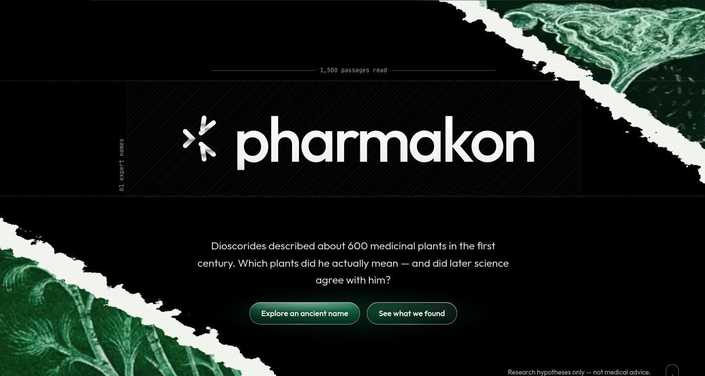

> [!IMPORTANT]
> **Research hypotheses only, not medical advice.** Pharmakon generates research hypotheses from historical texts and open databases. Nothing here is medical advice, a recommendation to use any plant, or evidence of safety or efficacy.

## In one minute

Around 60 AD, the Greek physician **Dioscorides** wrote *De materia medica*, about 600 medicinal plants and what each one treats. Doctors copied it for 1,500 years. Three problems stop anyone turning it into testable science:

1. **Nobody is sure which plant each ancient name means.** Pharmakon gives a probability for every candidate species, with an explicit "unidentified" option. It agrees with expert botanical historians **62%** of the time; the standard Greek dictionary manages **31%**.
2. **Nobody has measured, at scale, which uses survived.** Pharmakon follows every use through Galen (2nd c.), John the Physician (13th c.) and modern Greek villages. **49%** of uses recur today, against **40.5%** expected by chance (p = 0.001).
3. **Herb–disease predictions are rarely tested honestly.** Pharmakon runs a strict time-travel test and reports a null result: in this pilot, history did not predict which pairs science studied next beyond research popularity.

The output is **346 untested plant–condition leads**, each weighted by how sure we are of the plant, with toxicity and conservation flags. Ignoring that uncertainty would change 6 of the top 20.

Use it three ways: the **[website](https://pharmakon.adoranto737.workers.dev)**, the **MCP server** for AI assistants, or the **JSON API**. All three are below.

## Project status

| part | status |
|---|---|
| Pipeline: 12 CLI stages, Parquet with provenance on every row | done |
| Identification model, persistence test, temporal backtest, leads | done, results below |
| Website with explorer, charts and leads gallery | live on Cloudflare |
| MCP server (6 read-only tools) and JSON API | live on Cloudflare |
| Streamlit research dashboard, 24 tests | done |
| Calibration (ECE 0.21 vs target ≤ 0.10) | **missed**, cause identified below |
| Human audits of extraction, conditions, merges, labels | **pending**: blinded sheets generated in `data/gold/audits/` |
| LLM extraction and plant-morphology evidence | **not run**: needs `ANTHROPIC_API_KEY` |
| Pitch video, slides, Devpost page | team tasks |

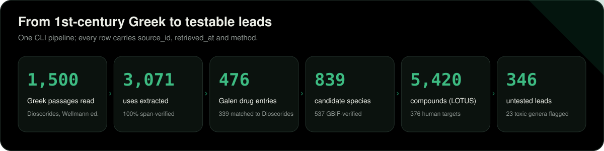

## A worked example

What the pipeline produces for one name, wormwood:


**ἀψίνθιον** (apsinthion), *De materia medica* 3.23 · `urn:cts:greekLit:tlg0656.tlg001.1st1K-grc1:3.23.1`

> ἀψίνθιον· γνώριμος ἡ πόα. ἐστι δὲ αὐτοῦ βέλτιον τὸ ἐν Πόντῳ καὶ Καππαδοκίᾳ γεννώμενον ἐν ὄρει τῳ καλουμένῳ Ταύρῳ. δύναμιν δὲ ἔχει στυπτικήν, θερμαντικήν, ἀποκαθαρτικὴν τῶν ἐνηρεικότων στομάχῳ καὶ κοιλίᾳ χολωδῶν. ἐστι δὲ καὶ οὐρητικὸν καὶ ἀκραίπαλον προπινόμενον, καὶ πρὸς ἐμπνευματώσεις δὲ ἁρμόζει καὶ κοιλίας καὶ στομάχου ἀλγήματα πινόμενον μετὰ σεσέλεως ἢ νάρδου Κελτικῆς, καὶ ἀνορεξίας καὶ ἰκτερικούς θεραπεύει τὸ ἀπόβρεγμα αὐτοῦ ἢ τὸ ἀφέψημα καθʼ ἑκάστην ἡμέραν λαμβανόμενον εἰς πλῆθος κυάθων τριῶν.

The model's answer:

| candidate | family | P(species) | 90% interval |
|---|---|---|---|
| *Artemisia absinthium* | Asteraceae | 0.68 | 0.53–0.84 |
| (unidentified) |  | 0.29 | 0.12–0.44 |
| *Artemisia monosperma* | Asteraceae | 0.03 | 0.01–0.05 |

The uses through time:

| use | Dioscorides | Galen | John the Physician | modern Greece (expected) |
|---|---|---|---|---|
| Blood, spleen | attested | absent | — | 0.00 |
| Cardiovascular | attested | absent | — | 0.00 |
| Skin & wounds | attested | attested | — | 0.71 |
| Digestive | attested | absent | — | 0.00 |
| Gynaecology | attested | absent | — | 0.00 |
| Liver & gall | attested | absent | — | 0.00 |
| Metabolic | attested | absent | — | 0.00 |
| Eyes | attested | attested | — | 0.00 |
| Ears | attested | absent | — | 0.00 |
| Nose & throat | attested | absent | — | 0.00 |
| Urinary | attested | absent | — | 0.00 |

The highlighted evidence spans, photos and the Galen passage for this name are shown in the explorer:

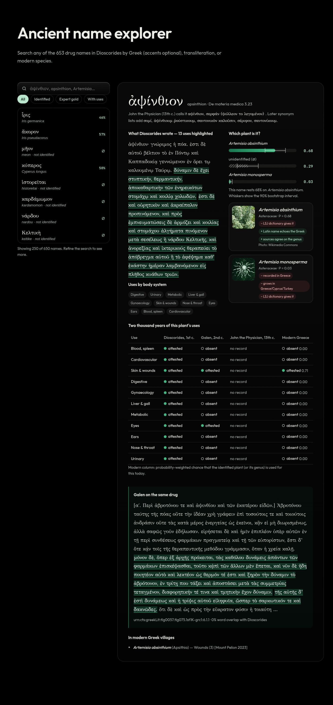

## Results

### 1. Which plant is it?

Each of the 61 names identified by Lardos et al. (2024) is held out in turn; the model ranks GBIF-verified candidates using geography, name continuity, scholarly agreement and genus consensus, with no pharmacology at all.

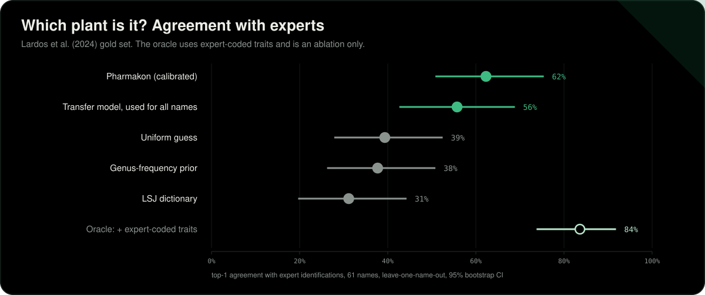

| model | top-1 [95% CI] | top-3 | mean reciprocal rank | Brier ↓ | ECE ↓ |
|---|---|---|---|---|---|
| **Pharmakon (calibrated)** | 0.62 [0.51, 0.75] | 0.92 | 0.78 | 0.50 | 0.21 |
| Pharmakon, before temperature scaling | 0.62 [0.51, 0.75] | 0.92 | 0.78 | 0.50 | 0.14 |
| Transfer model (no Lardos counts; used for all names) | 0.56 [0.43, 0.69] | 0.92 | 0.74 | 0.55 | 0.15 |
| …without the ethnobotanical-reference count | 0.62 [0.51, 0.74] | 0.90 | 0.77 | 0.51 | 0.18 |
| …without geography (f2) | 0.66 [0.54, 0.79] | 0.92 | 0.79 | 0.54 | 0.24 |
| …without name continuity (f3) | 0.62 [0.51, 0.75] | 0.92 | 0.78 | 0.49 | 0.18 |
| …without scholarly agreement (f4) | 0.54 [0.41, 0.67] | 0.90 | 0.72 | 0.55 | 0.14 |
| …without genus consensus (f6) | 0.66 [0.54, 0.79] | 0.92 | 0.80 | 0.49 | 0.20 |
| LSJ dictionary baseline | 0.31 [0.20, 0.44] | 0.80 | 0.57 | 1.34 | 0.69 |
| Genus-frequency prior | 0.38 [0.26, 0.51] | 0.87 | 0.62 | 0.59 | 0.09 |
| Uniform guess | 0.39 [0.28, 0.52] | 0.87 | 0.63 | 0.63 | 0.12 |
| *Oracle: + expert-coded traits (ablation only)* | 0.84 [0.74, 0.92] | 0.98 | 0.91 | 0.22 | 0.09 |

- The model beats the dictionary baseline on top-1 and on Brier score.
- Removing the one feature that overlaps the experts' own tie-break (the ethnobotanical-reference count) leaves top-1 unchanged, so the headline does not rest on it. The transfer model uses no Lardos-derived counts and is the cleanest number.

What the model learned (conditional-logit weights; the "unidentified" option has its own utility):

| feature | what it measures | weight (full) | weight (transfer) |
|---|---|---|---|
| `f2_geo_log_occ` | log(1 + GBIF occurrences in GR+CY+TR) | +0.20 | +0.37 |
| `f2_present_gr` | ≥1 GBIF occurrence in Greece | +0.68 | +0.68 |
| `f3_vernacular_sim` | max similarity of ancient name to modern Greek vernacular names (Wikidata P1843@el) | +0.03 | +0.03 |
| `f3_epithet_sim` | max similarity of Latinised ancient name to genus / epithet | +0.07 | +0.22 |
| `f4_lit_dmm` | log(1 + # botanical-history references proposing the taxon) [Lardos file 5] | +0.47 |  |
| `f4_lit_ethno` | log(1 + # ethnobotanical references linking the name to the taxon) [Lardos file 5] | +0.37 |  |
| `f4_lsj` | LSJ gives the binomial (1 asserted, 0.5 hedged) | -0.28 | -0.31 |
| `f6_genus_consensus` | share of the unit's candidates in the same genus | +0.17 | +0.16 |

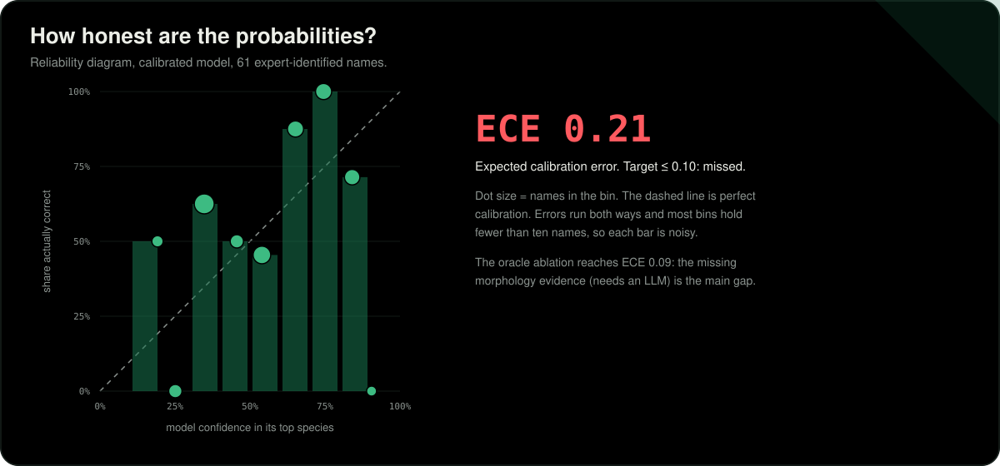

### 2. Did the uses survive?

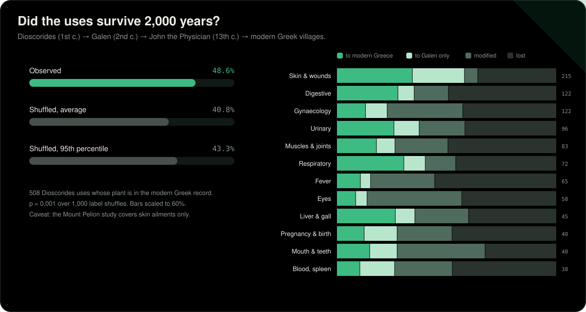

- Galen re-attests **39%** of Dioscorides' uses for the names that could be linked to his text, John the Physician **36%**.
- Galen is not copying: mean word 4-gram containment against Dioscorides is close to zero.

Survival by body system (Dioscorides uses whose plant could be identified):

| use group | persisted to modern Greece | to Galen only | to John the Physician only | modified | lost |
|---|---|---|---|---|---|
| Skin & wounds | 67 | 43 | 1 | 11 | 65 |
| Gynaecology | 14 | 9 | 0 | 39 | 41 |
| Digestive | 25 | 5 | 1 | 14 | 45 |
| Urinary | 21 | 9 | 2 | 18 | 32 |
| Muscles & joints | 13 | 6 | 0 | 17 | 30 |
| Respiratory | 17 | 3 | 2 | 8 | 25 |
| Eyes | 4 | 3 | 0 | 22 | 19 |
| Liver & gall | 11 | 3 | 0 | 10 | 16 |
| Pregnancy & birth | 5 | 6 | 1 | 10 | 16 |
| Mouth & teeth | 4 | 5 | 2 | 14 | 10 |
| Blood, spleen | 4 | 5 | 0 | 9 | 16 |
| Cardiovascular | 4 | 0 | 0 | 5 | 16 |
| Ears | 4 | 2 | 0 | 11 | 6 |
| Neurological | 5 | 1 | 0 | 5 | 10 |
| Other | 3 | 0 | 0 | 6 | 12 |
| Fever | 1 | 0 | 0 | 4 | 6 |
| Nose & throat | 1 | 1 | 0 | 4 | 5 |
| Infections | 0 | 0 | 0 | 3 | 4 |
| Metabolic | 0 | 0 | 0 | 1 | 1 |

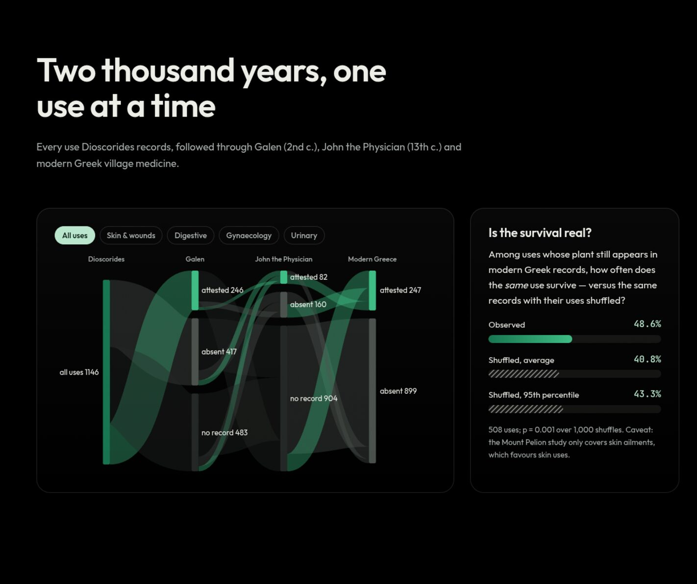

### 3. The time machine

Stand in 2000, 2005, 2010 or 2015, forget everything published after, rank the plant–condition pairs nobody had studied yet, then check PubMed up to 2025. Features are gated by date: compound reference years, ChEMBL document years and modern-study publication years must all precede the cutoff, and no LLM output is used.

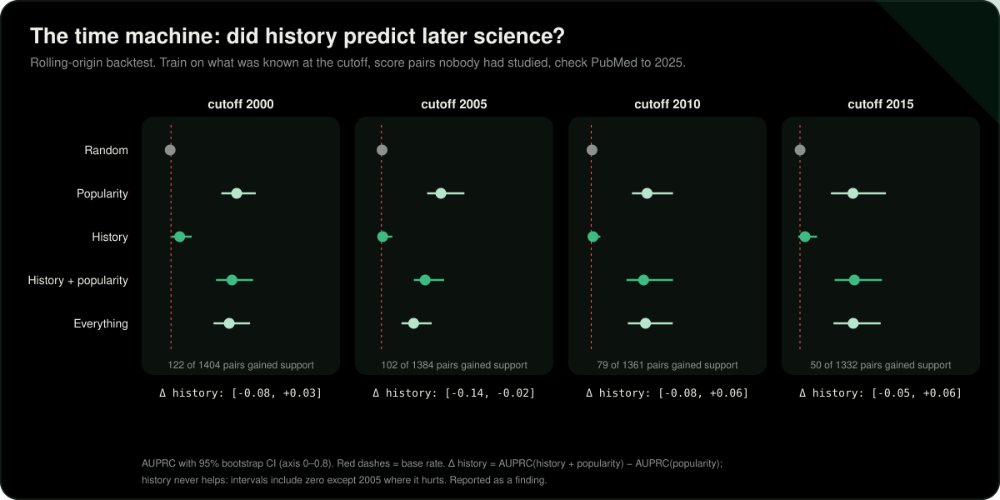

| cutoff | test pairs | gained support by 2025 | Random | Popularity | History | History + popularity | Everything | Δ history [95% CI] |
|---|---|---|---|---|---|---|---|---|
| 2000 | 392 | 46 | 0.11 | 0.17 [0.12, 0.24] | 0.15 [0.11, 0.21] | 0.16 [0.11, 0.24] | 0.16 [0.12, 0.26] | -0.07 to +0.04 |
| 2005 | 385 | 39 | 0.11 | 0.38 [0.29, 0.53] | 0.12 [0.09, 0.20] | 0.34 [0.23, 0.52] | 0.36 [0.24, 0.56] | -0.14 to +0.07 |
| 2010 | 373 | 27 | 0.13 | 0.56 [0.39, 0.72] | 0.09 [0.05, 0.14] | 0.55 [0.38, 0.73] | 0.31 [0.20, 0.49] | -0.06 to +0.06 |
| 2015 | 366 | 20 | 0.11 | 0.50 [0.28, 0.69] | 0.06 [0.03, 0.12] | 0.46 [0.25, 0.68] | 0.40 [0.21, 0.62] | -0.13 to +0.05 |

**Finding: a null.** Historical features alone score close to random, and adding them to research popularity never moves AUPRC beyond its confidence interval. The history coefficients are mostly negative, which points to selection: a pair is eligible only while unstudied, so well-attested remedies that science studied early drop out of the pool. Labels are a PubMed co-mention proxy awaiting a human audit.

### 4. Leads for the lab

Plant–condition pairs used historically, with **no matching PubMed pharmacology paper yet**, ranked by forecast score × P(species). The top 20:

> [!WARNING]
> Hypotheses to test, never advice to use. Rows marked ⚠ contain a compound with a PubChem GHS hazard record.

<table>
<tr><td width="25%" align="center"><a href="https://commons.wikimedia.org/wiki/File:Heliotropium%20europaeum3.jpg"></a><br><sub><b>#1</b> <i>Heliotropium europaeum</i> ⚠<br>Skin Diseases · P = 0.80</sub></td><td width="25%" align="center"><a href="https://commons.wikimedia.org/wiki/File:Frouzet%20fg02.jpg"></a><br><sub><b>#2</b> <i>Quercus ilex</i><br>Inflammation · P = 0.59</sub></td><td width="25%" align="center"><a href="https://commons.wikimedia.org/wiki/File:Sorghum%20halepense-Sorgho%20d%27Alep-20150622.jpg"></a><br><sub><b>#4</b> <i>Sorghum halepense</i><br>Inflammation · P = 0.57</sub></td><td width="25%" align="center"><a href="https://commons.wikimedia.org/wiki/File:Glycyrrhiza%20echinata%20MHNT.BOT2004.0.97.jpg"></a><br><sub><b>#5</b> <i>Glycyrrhiza echinata</i><br>Wounds and Injuries · P = 0.55</sub></td></tr>
<tr><td width="25%" align="center"><a href="https://commons.wikimedia.org/wiki/File:%28MHNT%29%20Raphanus%20raphanistrum%20-%20flowers.jpg"></a><br><sub><b>#6</b> <i>Raphanus raphanistrum</i><br>Wounds and Injuries · P = 0.44</sub></td><td width="25%" align="center"><a href="https://commons.wikimedia.org/wiki/File:Cynodon%20dactylon%20RF.jpg"></a><br><sub><b>#8</b> <i>Cynodon dactylon</i><br>Wounds and Injuries · P = 0.27</sub></td><td width="25%" align="center"><a href="https://commons.wikimedia.org/wiki/File:Illustration%20Vicia%20faba1.jpg"></a><br><sub><b>#10</b> <i>Vicia faba</i><br>Cicatrix · P = 0.67</sub></td><td width="25%" align="center"><a href="https://commons.wikimedia.org/wiki/File:Rumex%20patientia%20kz01.jpg"></a><br><sub><b>#11</b> <i>Rumex patientia</i><br>Skin Diseases · P = 0.37</sub></td></tr>
<tr><td width="25%" align="center"><a href="https://commons.wikimedia.org/wiki/File:Groundsel%20%28Senecio%20vulgaris%29%20%2810171293746%29.jpg"></a><br><sub><b>#13</b> <i>Senecio vulgaris</i> ⚠<br>Inflammation · P = 0.62</sub></td><td width="25%" align="center"><a href="https://commons.wikimedia.org/wiki/File:Radish%203371103037%204ab07db0bf%20o.jpg"></a><br><sub><b>#14</b> <i>Raphanus sativus</i><br>Skin Ulcer · P = 0.41</sub></td><td width="25%" align="center"><a href="https://commons.wikimedia.org/wiki/File:Artemisia%20arborescens%2012052004%20Var.jpg"></a><br><sub><b>#15</b> <i>Artemisia arborescens</i><br>Inflammation · P = 0.65</sub></td><td width="25%" align="center"><a href="https://commons.wikimedia.org/wiki/File:Ruta%20graveolens%20-%20K%C3%B6hler%E2%80%93s%20Medizinal-Pflanzen-259.jpg"></a><br><sub><b>#16</b> <i>Ruta graveolens</i><br>Skin Ulcer · P = 0.52</sub></td></tr>
</table>

<sub>Photos of the top leads with a Wikimedia Commons image (Wikidata P18; each file under its own licence, click for the file page). ⚠ = known toxic constituent.</sub>

| # | species | condition (MeSH) | P(species) | lead score | toxicity | IUCN | used in modern Greece | rank if certainty ignored |
|---|---|---|---|---|---|---|---|---|
| 1 | *Heliotropium europaeum* | Skin Diseases | 0.80 | 0.380 | ⚠ known toxic constituent ([PubChem](https://pubchem.ncbi.nlm.nih.gov/compound/5281735)) |  |  | 6 |
| 2 | *Quercus ilex* | Inflammation | 0.59 | 0.362 |  | least concern | yes | 2 |
| 3 | *Prunus domestica* | Skin Diseases | 0.44 | 0.362 |  |  | yes | 1 |
| 4 | *Sorghum halepense* | Inflammation | 0.57 | 0.307 |  |  |  | 4 |
| 5 | *Glycyrrhiza echinata* | Wounds and Injuries | 0.55 | 0.275 |  |  | yes | 5 |
| 6 | *Raphanus raphanistrum* | Wounds and Injuries | 0.44 | 0.267 |  |  |  | 3 |
| 7 | *Teucrium scordium* | Wounds and Injuries | 0.65 | 0.221 | ⚠ known toxic constituent ([PubChem](https://pubchem.ncbi.nlm.nih.gov/compound/159529)) |  | yes | 7 |
| 8 | *Cynodon dactylon* | Wounds and Injuries | 0.27 | 0.214 |  |  |  | 247 |
| 9 | *Juniperus sabina* | Inflammation | 0.50 | 0.201 |  |  | yes | 247 |
| 10 | *Vicia faba* | Cicatrix | 0.67 | 0.197 |  |  |  | 12 |
| 11 | *Rumex patientia* | Skin Diseases | 0.37 | 0.183 |  |  | yes | 247 |
| 12 | *Arctium lappa* | Skin Ulcer | 0.59 | 0.177 |  |  |  | 11 |
| 13 | *Senecio vulgaris* | Inflammation | 0.62 | 0.167 | ⚠ known toxic constituent ([PubChem](https://pubchem.ncbi.nlm.nih.gov/compound/5281743)) |  |  | 16 |
| 14 | *Raphanus sativus* | Skin Ulcer | 0.41 | 0.163 |  |  |  | 247 |
| 15 | *Artemisia arborescens* | Inflammation | 0.65 | 0.162 |  |  | yes | 17 |
| 16 | *Ruta graveolens* | Skin Ulcer | 0.52 | 0.161 |  |  | yes | 9 |
| 17 | *Pistacia lentiscus* | Cicatrix | 0.72 | 0.160 |  | least concern | yes | 21 |
| 18 | *Achillea millefolium* | Skin Ulcer | 0.55 | 0.155 |  | least concern |  | 13 |
| 19 | *Galanthus nivalis* | Inflammation | 0.34 | 0.155 | ⚠ known toxic constituent ([PubChem](https://pubchem.ncbi.nlm.nih.gov/compound/121587)) | near threatened |  | 247 |
| 20 | *Lupinus albus* | Pruritus | 0.54 | 0.150 | ⚠ known toxic constituent ([PubChem](https://pubchem.ncbi.nlm.nih.gov/compound/72325)) | least concern |  | 14 |

- **7** of the top 20 rest on a plant identification below 0.5.
- **5** of the top 20 carry a known-toxicity flag.
- Ranking by the single most likely plant instead of the full probability changes 6 of the top 20 (Kendall τ = 0.58).

Leads by condition:

| condition | leads | best lead | its P(species) | flagged toxic |
|---|---|---|---|---|
| Skin Ulcer | 61 | *Arctium lappa* (#12) | 0.59 | 4 |
| Bites and Stings | 44 | *Vicia faba* (#24) | 0.67 | 3 |
| Inflammation | 27 | *Quercus ilex* (#2) | 0.59 | 3 |
| Wounds and Injuries | 26 | *Glycyrrhiza echinata* (#5) | 0.55 | 3 |
| Edema | 24 | *Quercus ilex* (#40) | 0.59 | 2 |
| Erysipelas | 22 | *Ricinus communis* (#118) | 0.64 | 3 |
| Burns | 16 | *Galium verum* (#47) | 0.69 | 0 |
| Melanosis | 14 | *Raphanus sativus* (#58) | 0.41 | 3 |
| Pruritus | 13 | *Lupinus albus* (#20) | 0.54 | 3 |
| Alopecia | 13 | *Raphanus sativus* (#21) | 0.41 | 1 |
| Contusions | 12 | *Raphanus sativus* (#95) | 0.41 | 2 |
| Gangrene | 11 | *Lupinus albus* (#73) | 0.54 | 2 |

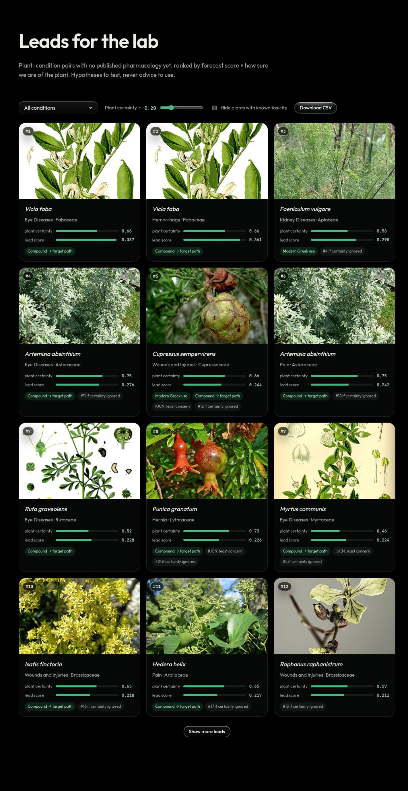

## Use it

### From an AI assistant (MCP)

The MCP server runs on the same Cloudflare Worker as the site. It is read-only, needs no key, and every reply carries the research-only notice and toxicity flags.

**Claude Code**

```bash
claude mcp add --transport http pharmakon https://pharmakon.adoranto737.workers.dev/mcp
```

**Claude Desktop / claude.ai:** Settings → Connectors → *Add custom connector* → `https://pharmakon.adoranto737.workers.dev/mcp`

**Cursor, Windsurf, VS Code and other clients** (`mcp.json`):

```json
{
  "mcpServers": {
    "pharmakon": { "url": "https://pharmakon.adoranto737.workers.dev/mcp" }
  }
}
```

Clients that only speak stdio can bridge with `npx mcp-remote https://pharmakon.adoranto737.workers.dev/mcp`.

| tool | what it returns |
|---|---|
| `search_ancient_names` | Search the ~650 plant and drug names in Dioscorides' De materia medica (1st c.) by Greek (accents optional), transliteration, or modern Latin species. Returns ids for get_ancient_name. |
| `get_ancient_name` | Full record for one ancient name: Greek passages with CTS URNs and verbatim evidence spans, extracted uses, P(species | name) with 90% intervals, the use's survival through Galen, John the Physician (13th c.) and modern Greece, and modern Greek folk uses. |
| `list_leads` | Ranked research leads: plant–condition pairs used historically, with no matching PubMed pharmacology paper yet, weighted by identification certainty. Always check known_toxicity. |
| `get_lead` | One lead by rank with its compound → human target → disease evidence paths (LOTUS, ChEMBL, Open Targets) and the exact PubMed query behind its 'unstudied' label. |
| `list_conditions` | Conditions that have leads, with counts. Use the names as list_leads condition filters. |
| `get_results` | Evaluation results with confidence intervals: overview, identification (vs expert gold), persistence (vs permutation null), forecast (rolling-origin backtest), leads, labels, extraction, texts, chemistry, galen, graph. |

Things to ask:

- *"Which ancient Greek plants were used for burns, and how sure are we of each identification?"*
- *"Show the evidence for lead #2 and the PubMed query behind it."*
- *"Did Galen agree with Dioscorides about wormwood?"*
- *"How well did the backtest do in 2010?"*

### From code (JSON API)

Plain HTTPS GET, no key, CORS open. Same data and disclaimer as the MCP tools.

| endpoint | returns |
|---|---|
| `GET /api/names?q=&filter=&limit=` | ancient names matching Greek, transliteration or Latin species |
| `GET /api/names/{id}` | one name: passages, uses, identification, survival, Galen, modern uses |
| `GET /api/leads?condition=&species=&min_p=&hide_toxic=&limit=&offset=` | ranked leads |
| `GET /api/leads/{rank}` | one lead with compound → target → disease paths |
| `GET /api/conditions` | conditions with lead counts |
| `GET /api/results?section=` | evaluation results (`overview`, `identification`, `persistence`, `forecast`, …) |

```bash
curl "https://pharmakon.adoranto737.workers.dev/api/leads?condition=burn&hide_toxic=true&limit=3"
```

```python
import requests
r = requests.get("https://pharmakon.adoranto737.workers.dev/api/names", params={"q": "Artemisia"}).json()
for n in r["results"]:
    print(n["lemma"], n["top_species"], n["p_top"])
```

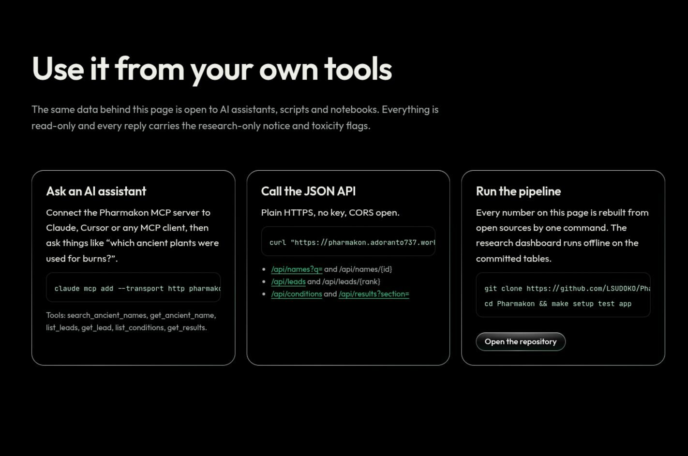

### On the website

<table>
<tr>
<td width="50%">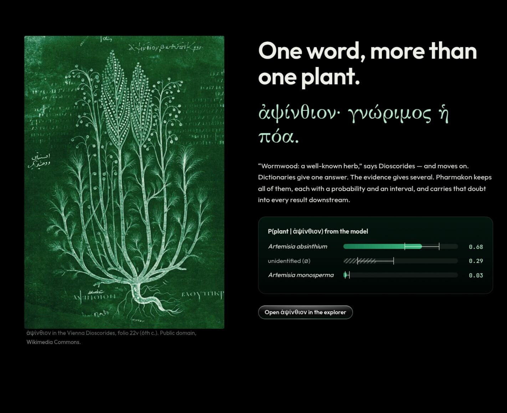<br><b>The problem in one word.</b> One Greek name, several candidate plants, each with a probability.</td>
<td width="50%">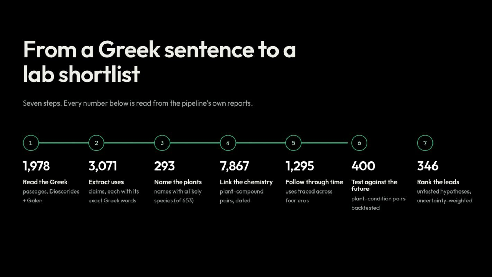<br><b>How it works.</b> Read, extract, identify, trace, test, rank.</td>
</tr>
<tr>
<td width="50%">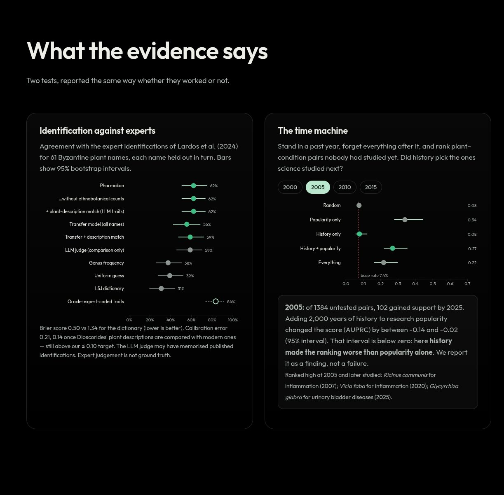<br><b>What the evidence says.</b> Both tests, reported the same way whether they worked or not.</td>
<td width="50%">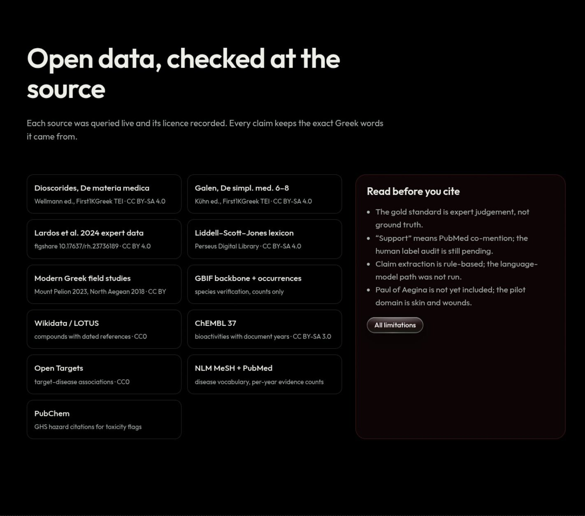<br><b>Open data.</b> Every source checked live, licences recorded, limits stated.</td>
</tr>
</table>

### Run it yourself

```bash
git clone https://github.com/LSUDOKO/Pharmakon && cd Pharmakon
make setup      # uv venv + install (Python 3.12)
make test       # 24 tests: parser, extraction, model, metrics, provenance guard, app pages
make app        # Streamlit research dashboard on the committed tables (no network)
make data verify   # download raw sources, check every API live
make reproduce     # the full pipeline from scratch
make readme        # regenerate this README's charts and tables
```

From a fresh clone, PubMed takes about an hour without an NCBI key. Optional keys go in `.env`: `ANTHROPIC_API_KEY` (LLM extraction), `NCBI_API_KEY`, `IUCN_TOKEN`.

Rebuild and deploy the site, API and MCP server (from `web/`): `npm install && npm run data && npm run deploy`.

## Method

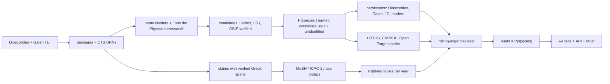

| stage | command | output |
|---|---|---|
| Read texts | `python -m pharmakon ingest-texts` | 1,500 passages, 835 chapters, headwords parsed 97.6% |
| Extract uses | `python -m pharmakon extract-claims` | 3,071 claims, 0 span mismatches, extractor `rule_extract_v1` |
| Map conditions | `python -m pharmakon map-conditions` | 124 Greek conditions, 104 with verified MeSH, 20 with no modern equivalent |
| Expert gold | `python -m pharmakon gold` | 61 Dioscorides names, 50 John the Physician lemmas |
| Identify plants | `python -m pharmakon identify` | 839 candidates, 537 of 683 names verified in GBIF |
| Read Galen | `python -m pharmakon ingest-galen` | 476 drug entries, 920 claims, copy containment 0.002 |
| Link chemistry | `python -m pharmakon link-chemistry` | 5,420 compounds, 376 human targets, 1,244 closed paths |
| Trace persistence | `python -m pharmakon persistence` | 1,295 name × use rows, 1,226 modern records |
| Label evidence | `python -m pharmakon evidence-labels` | 400 plant–condition pairs, 54 with PubMed support by 2025 |
| Backtest | `python -m pharmakon forecast` | cutoffs 2000, 2005, 2010, 2015 |
| Rank leads | `python -m pharmakon leads` | 346 untested pairs, Kendall τ 0.58 vs top-1 identity |
| Knowledge graph | `python -m pharmakon build-kg` | 2,259 nodes, 6,048 edges |

Rules the pipeline enforces:

- **Verbatim evidence.** Every extracted claim stores the exact Greek substring and its CTS URN; a Unicode-normalised substring check archives any mismatch instead of keeping it.
- **Provenance everywhere.** Every row carries `source_id`, `retrieved_at` and `method`; a test fails the build if a table lacks them.
- **Generate, then verify.** Species names are verified against GBIF, diseases against MeSH, compounds by InChIKey. Unverifiable candidates are dropped and counted.
- **No leakage.** Backtest features use only information dated on or before the cutoff; LLM outputs are never used as a score.

## Data and licences

| data | source | licence |
|---|---|---|
| Dioscorides, *De materia medica* (Wellmann), TEI | First1KGreek / Open Greek and Latin | CC BY-SA 4.0 |
| Galen, *De simpl. med. temp. ac fac.* books 6–8 (Kühn), TEI | First1KGreek | CC BY-SA 4.0 |
| Liddell–Scott–Jones Greek lexicon | Perseus Digital Library | CC BY-SA 4.0 |
| Expert identifications, John the Physician crosswalk | Lardos et al. 2024, figshare | CC BY 4.0 |
| Mount Pelion ethnobotany | Tsioutsiou et al. 2023 | CC BY |
| North Aegean ethnobotany | Axiotis et al. 2018 | CC BY |
| Taxonomy and Greek/Cypriot/Turkish occurrences | GBIF backbone + occurrence API | CC0 / CC BY |
| Vernacular names, conservation status, plant photos | Wikidata / Wikimedia Commons | CC0 / per file |
| Plant → compound occurrences | LOTUS via Wikidata | CC0 |
| Compound → target activity | ChEMBL 37 | CC BY-SA 3.0 |
| Target → disease association | Open Targets Platform | CC0 |
| Disease vocabulary | NLM MeSH | public domain |
| Evidence labels (co-mention) | PubMed E-utilities | NLM terms |
| Toxicity citations (GHS) | PubChem | public domain |

Every source was checked live before use; the checks are recorded in `docs/source_verification.md`. Modern translations under copyright (Beck, Osbaldeston) are not used.

## Research roadmap

What would make the results stronger, in order of value per effort:

| next step | what it fixes | needs |
|---|---|---|
| Fill the four blinded audit sheets | turns proxy precision into audited numbers | expert reviewer time |
| LLM claim extraction + plant-morphology evidence | recall beyond the lexicon; morphology is the gap the oracle ablation exposes (expert traits give top-1 0.84, ECE 0.09: an upper bound) | `ANTHROPIC_API_KEY` |
| Expand from the skin/wound pilot to all body systems | more positives per cutoff, so the backtest can detect a real effect | several hours of PubMed queries, then a full rerun |
| Historical Open Targets snapshots | removes the last time-leak in the chemistry features | archived releases |
| Paul of Aegina (7th c.), Oribasius, Aetius | completes the Byzantine chain | no open TEI exists yet; OCR of the CMG editions |
| Arabic and Latin transmission (Ibn al-Bayṭār, Latin Dioscorides) | follows the remedies out of the Greek world | new corpora and lexica |
| Zenodo release with DOI | citable, versioned dataset | release step |
| Screening partnership for top non-toxic leads | the only real test of a lead | a pharmacognosy lab |

## Limitations

- **Expert gold, not ground truth.** The gold standard is the judgement of Lardos et al.; intervals are wide with 61 names.
- **Proxy labels.** "Supported" means a PubMed co-mention with a pharmacology filter, not a validated finding. Its precision is not yet audited.
- **No LLM.** Extraction is rule-based (exact spans, limited recall) and the morphology stream is absent, which is the main calibration gap.
- **Pilot scope.** Leads and the backtest cover the skin/wound domain; the Mount Pelion study covers skin ailments only, which favours skin uses in the persistence test.
- **Text chain.** Paul of Aegina is missing; John the Physician is reached only through the 50 plants Lardos et al. analysed; 137 of 476 Galen entries are unmapped.
- **Chemistry.** LOTUS via Wikidata, capped at 15 compounds per taxon and 120 taxa; human single-protein targets only; Open Targets associations are current, so a sensitivity model without them is reported.
- **Conservation status** comes from Wikidata P141, not the IUCN API.

## Responsible research

- No dosing is displayed; quantities appear only inside quoted historical text.
- Toxic genera carry a PubChem GHS citation resolved live; every API and MCP reply repeats the disclaimer.
- Modern ethnobotanical data are used only at the aggregate species and use level from published tables.
- Folk knowledge belongs to the documented communities: access-and-benefit-sharing under the Nagoya Protocol applies to any commercial follow-up.

## Cite and acknowledge

Pharmakon (2026). *An uncertainty-aware, 2,000-year map of Greek and Byzantine pharmacology.* https://github.com/LSUDOKO/Pharmakon

Built for EthnoHack 2026, Track 1 (Traditional knowledge). Thanks to Open Greek and Latin (First1KGreek), the Perseus Digital Library, Lardos et al. (2024), Tsioutsiou et al. (2023), Axiotis et al. (2018), GBIF, Wikidata and LOTUS, NLM, EMBL-EBI ChEMBL, Open Targets and PubChem. Manuscript images: Vienna Dioscorides (Codex Vindobonensis med. gr. 1), public domain.

Code: MIT. Data: under each source's licence, listed above.
