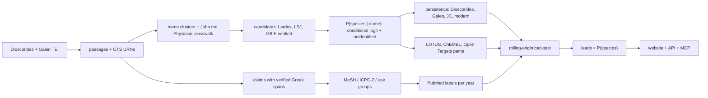

<!-- README.md is generated from docs/README.template.md by `make readme`. Edit the template, not README.md. -->

<p align="center">
  <picture>
    <source media="(prefers-color-scheme: dark)" srcset="readme/logo-dark.png">
    
  </picture>
</p>

<p align="center"><b>2,000 years of Greek plant medicine, measured.</b><br>
An uncertainty-aware map from Dioscorides' 1st-century Greek to modern species, chemistry and untested research leads.</p>

<p align="center">
  <a href="https://youtu.be/d-kbvFd2K04"></a>
  <a href="https://drive.google.com/file/d/1cX2WHtz4g6Yu8RxI-wfN-3ifHq9VsYnv/view?usp=sharing"></a>
  <a href="https://pharmakon.adoranto737.workers.dev"></a>
  <a href="https://pharmakon.adoranto737.workers.dev/mcp"></a>
  <br>
  <a href="https://github.com/LSUDOKO/Pharmakon/actions/workflows/ci.yml"></a>
  <a href="https://doi.org/10.5281/zenodo.24106413"></a>
  <a href="https://github.com/LSUDOKO/Pharmakon/releases/latest"></a>
  <a href="https://github.com/LSUDOKO/Pharmakon/pkgs/container/pharmakon"></a>
  
  <a href="LICENSE"></a>
  
</p>


> [!IMPORTANT]
> **Research hypotheses only, not medical advice.** Pharmakon generates research hypotheses from historical texts and open databases. Nothing here is medical advice, a recommendation to use any plant, or evidence of safety or efficacy.

## Watch the film

<table>
<tr>
<td width="58%"><a href="https://youtu.be/d-kbvFd2K04"></a></td>
<td width="42%">

**[▶ Watch the film on YouTube](https://youtu.be/d-kbvFd2K04)** (9 min)<br>
The problem, the data, the method, a live demo of the site and of the MCP server inside Claude, and every result, including the one that did not work.

**[Pitch deck](https://drive.google.com/file/d/1cX2WHtz4g6Yu8RxI-wfN-3ifHq9VsYnv/view?usp=sharing)** (Google Drive)<br>
**[Slides, PDF](docs/slides/Pharmakon_EthnoHack2026_slides.pdf)** (10 slides, built from the pipeline outputs)<br>
**[Live site](https://pharmakon.adoranto737.workers.dev)** · **[MCP endpoint](https://pharmakon.adoranto737.workers.dev/mcp)** · **[Latest release](https://github.com/LSUDOKO/Pharmakon/releases/latest)**

</td>
</tr>
</table>

## In one minute

Around 60 AD, the Greek physician **Dioscorides** wrote *De materia medica*, about 600 medicinal plants and what each one treats. Doctors copied it for 1,500 years. Three problems stop anyone turning it into testable science:

1. **Nobody is sure which plant each ancient name means.** Pharmakon gives a probability for every candidate species, with an explicit "unidentified" option. It agrees with expert botanical historians **{{TOP1}}** of the time; the standard Greek dictionary manages **{{LSJ}}**.
2. **Nobody has measured, at scale, which uses survived.** Pharmakon follows every use through Galen (2nd c.), John the Physician (13th c.) and the modern record (Greek and Cypriot ethnobotanical and herbal-medicine sources). **{{PERSIST}}** of uses recur today, against **{{NULL}}** expected by chance (p = {{PVAL}}).
3. **Herb–disease predictions are rarely tested honestly.** Pharmakon runs a strict time-travel test across all body systems and reports a null result: history did not predict which pairs science studied next beyond research popularity.

The output is **{{LEADS}} untested plant–condition leads**, each weighted by how sure we are of the plant, with toxicity and conservation flags. Ignoring that uncertainty would change {{CHANGED}} of the top 20.

Use it three ways: the **[website](https://pharmakon.adoranto737.workers.dev)**, the **MCP server** for AI assistants, or the **JSON API**. All three are below.

## Project status

| part | status |
|---|---|
| Pipeline: 13 CLI stages, Parquet with provenance on every row | done |
| Identification model, persistence test, temporal backtest, leads | done, results below |
| Website with explorer, charts and leads gallery | live on Cloudflare |
| MCP server (6 read-only tools) and JSON API | live on Cloudflare |
| Streamlit research dashboard, 27 tests, CI on every push | done |
| Calibration (ECE {{ECE}} vs target ≤ 0.10) | **missed**, cause identified below |
| Human audits of extraction, conditions, merges, labels | **pending**: blinded sheets generated in `data/gold/audits/` |
| LLM claim extraction, LLM lexicon extension, plant-morphology feature, LLM-judge baseline | done (Claude session + Groq), every span re-verified; kept out of the backtest |
| All body systems (beyond the skin/wound pilot) | done: PubMed labels and chemistry re-run for every use group |
| Slide deck (10 slides, PDF) | done: `docs/slides/Pharmakon_EthnoHack2026_slides.pdf`, built from the pipeline outputs by `docs/slides/build_slides.py` |
| Pitch film (9 min) and pitch deck | done: [YouTube](https://youtu.be/d-kbvFd2K04) · [deck](https://drive.google.com/file/d/1cX2WHtz4g6Yu8RxI-wfN-3ifHq9VsYnv/view?usp=sharing) |


## A worked example

What the pipeline produces for one name, wormwood:

{{EXAMPLE}}

The highlighted evidence spans, photos and the Galen passage for this name are shown in the explorer:


<details><summary>Still image</summary>


</details>

## Results

### 1. Which plant is it?

Each of the 61 names identified by Lardos et al. (2024) is held out in turn; the model ranks GBIF-verified candidates using geography, name continuity, scholarly agreement and genus consensus, with no pharmacology at all.


{{TABLE_IDENTIFICATION}}

- The model beats the dictionary baseline on top-1 and on Brier score.
- Removing the one feature that overlaps the experts' own tie-break (the ethnobotanical-reference count) leaves top-1 unchanged, so the headline does not rest on it. The transfer model uses no Lardos-derived counts and is the cleanest number.

What the model learned (conditional-logit weights; the "unidentified" option has its own utility):

{{TABLE_WEIGHTS}}


### 2. Did the uses survive?


- Galen re-attests **{{GALEN}}** of Dioscorides' uses for the names that could be linked to his text, John the Physician **{{JC}}**.
- Galen is not copying: mean word 4-gram containment against Dioscorides is close to zero.

Survival by body system (Dioscorides uses whose plant could be identified):

{{TABLE_PERSISTENCE}}


### 3. The time machine

Stand in 2000, 2005, 2010 or 2015, forget everything published after, rank the plant–condition pairs nobody had studied yet, then check PubMed up to 2025. Features are gated by date: compound reference years, ChEMBL document years and modern-study publication years must all precede the cutoff, and no LLM output is used.


{{TABLE_BACKTEST}}

The same test on the skin/wound pilot and on all body systems (more positives per cutoff):

{{TABLE_SCOPES}}

**Finding: a null.** Historical features alone score close to random, and adding them to research popularity never moves AUPRC beyond its confidence interval. The history coefficients are mostly negative, which points to selection: a pair is eligible only while unstudied, so well-attested remedies that science studied early drop out of the pool. Labels are a PubMed co-mention proxy awaiting a human audit.

### 4. What the LLM layer added

Two LLMs were used, and neither is ever the final authority. A Claude session (claude-opus-5-5) read all Greek passages twice (once for therapeutic claims, once for the plant's described form), turned most modern Wikipedia descriptions into the same trait vocabulary, and played the LLM-judge baseline without access to the expert answers. Groq's `openai/gpt-oss-120b` (temperature 0, cached API calls) extracted traits for the first 121 species until its daily token budget ran out. Every LLM output carries a verbatim span that the pipeline re-checks against the source; claims reach MeSH only through the verified lexicon; and **nothing LLM-derived enters the temporal backtest**, which keeps the deterministic claims and the frozen non-LLM identification.

{{TABLE_LLM}}

The morphology feature (f1) compares what Dioscorides says a plant looks like with what a modern description says, trait by trait (habit, height, leaf form, flower colour, fruit, root, smell, taste, habitat …). Its effect on identification is in the first table above (rows marked f1).

### 5. Leads for the lab

Plant–condition pairs used historically, with **no matching PubMed pharmacology paper yet**, ranked by forecast score × P(species). The top 20:

> [!WARNING]
> Hypotheses to test, never advice to use. Rows marked ⚠ contain a compound with a PubChem GHS hazard record.


{{GALLERY_LEADS}}

<sub>One photo per species, best-ranked lead first: Wikimedia Commons image (Wikidata P18; each file under its own licence, click for the file page). ⚠ = known toxic constituent.</sub>

{{TABLE_LEADS}}

- **{{LOWP}}** of the top 20 rest on a plant identification below 0.5.
- **{{TOX20}}** of the top 20 carry a known-toxicity flag.
- Ranking by the single most likely plant instead of the full probability changes {{CHANGED}} of the top 20 (Kendall τ = {{TAU}}).

Leads by condition:

{{TABLE_CONDITIONS}}


## Use it

### From an AI assistant (MCP)

The MCP server runs on the same Cloudflare Worker as the site. It is read-only, needs no key, and every reply carries the research-only notice and toxicity flags.


**Claude Code**

```bash
claude mcp add --transport http pharmakon https://pharmakon.adoranto737.workers.dev/mcp
```

**Claude Desktop / claude.ai:** Settings → Connectors → *Add custom connector* → `https://pharmakon.adoranto737.workers.dev/mcp`

**Cursor, Windsurf, VS Code and other clients** (`mcp.json`):

```json
{
  "mcpServers": {
    "pharmakon": { "url": "https://pharmakon.adoranto737.workers.dev/mcp" }
  }
}
```

Clients that only speak stdio can bridge with `npx mcp-remote https://pharmakon.adoranto737.workers.dev/mcp`.

{{TABLE_MCP}}

Things to ask:

- *"Which ancient Greek plants were used for burns, and how sure are we of each identification?"*
- *"Show the evidence for lead #2 and the PubMed query behind it."*
- *"Did Galen agree with Dioscorides about wormwood?"*
- *"How well did the backtest do in 2010?"*

### From code (JSON API)

Plain HTTPS GET, no key, CORS open. Same data and disclaimer as the MCP tools.

| endpoint | returns |
|---|---|
| `GET /api/names?q=&filter=&limit=` | ancient names matching Greek, transliteration or Latin species |
| `GET /api/names/{id}` | one name: passages, uses, identification, survival, Galen, modern uses |
| `GET /api/leads?condition=&species=&min_p=&hide_toxic=&limit=&offset=` | ranked leads |
| `GET /api/leads/{rank}` | one lead with compound → target → disease paths |
| `GET /api/conditions` | conditions with lead counts |
| `GET /api/results?section=` | evaluation results (`overview`, `identification`, `persistence`, `forecast`, …) |

```bash
curl "https://pharmakon.adoranto737.workers.dev/api/leads?condition=burn&hide_toxic=true&limit=3"
```

```python
import requests
r = requests.get("https://pharmakon.adoranto737.workers.dev/api/names", params={"q": "Artemisia"}).json()
for n in r["results"]:
    print(n["lemma"], n["top_species"], n["p_top"])
```


### On the website

<table>
<tr>
<td width="50%"><br><b>The problem in one word.</b> One Greek name, several candidate plants, each with a probability.</td>
<td width="50%"><br><b>How it works.</b> Read, extract, identify, trace, test, rank.</td>
</tr>
<tr>
<td width="50%"><br><b>What the evidence says.</b> Both tests, reported the same way whether they worked or not.</td>
<td width="50%"><br><b>Open data.</b> Every source checked live, licences recorded, limits stated.</td>
</tr>
</table>

### Run it yourself

```bash
git clone https://github.com/LSUDOKO/Pharmakon && cd Pharmakon
make setup      # uv venv + install (Python 3.12)
make test       # 27 tests: parser, extraction, model, metrics, provenance guard, app pages
make app        # Streamlit research dashboard on the committed tables (no network)
make data verify   # download raw sources, check every API live
make reproduce     # the full pipeline from scratch
make readme        # regenerate this README's charts and tables
```

Or pull the container (CLI and committed tables, no network needed for the dashboard):

```bash
docker run --rm ghcr.io/lsudoko/pharmakon:latest --help
docker run --rm -p 8501:8501 --entrypoint streamlit ghcr.io/lsudoko/pharmakon:latest run src/pharmakon/app/Home.py --server.address=0.0.0.0
```

From a fresh clone, PubMed takes about an hour without an NCBI key. Optional keys go in `.env`: `ANTHROPIC_API_KEY` (LLM extraction), `NCBI_API_KEY`, `IUCN_TOKEN`.

Rebuild and deploy the site, API and MCP server (from `web/`): `npm install && npm run data && npm run deploy`.

## Method




{{TABLE_STAGES}}

Rules the pipeline enforces:

- **Verbatim evidence.** Every extracted claim stores the exact Greek substring and its CTS URN; a Unicode-normalised substring check archives any mismatch instead of keeping it.
- **Provenance everywhere.** Every row carries `source_id`, `retrieved_at` and `method`; a test fails the build if a table lacks them.
- **Generate, then verify.** Species names are verified against GBIF, diseases against MeSH, compounds by InChIKey. Unverifiable candidates are dropped and counted.
- **No leakage.** Backtest features use only information dated on or before the cutoff; LLM outputs are never used as a score.

## Data and licences

{{TABLE_SOURCES}}

Every source was checked live before use; the checks are recorded in `docs/source_verification.md`. Modern translations under copyright (Beck, Osbaldeston) are not used.

## Research roadmap

What would make the results stronger, in order of value per effort:

| next step | what it fixes | needs |
|---|---|---|
| Fill the four blinded audit sheets (now also covering LLM claims and the LLM lexicon extension) | turns proxy precision into audited numbers | expert reviewer time |
| Richer modern descriptions (Flora of Greece, POWO with permission) | f1 compares only ~3 traits per candidate today | data access |
| Historical Open Targets snapshots | removes the last time-leak in the chemistry features | archived releases |
| Paul of Aegina (7th c.), Oribasius, Aetius | completes the Byzantine chain | no open TEI exists yet; OCR of the CMG editions |
| Arabic and Latin transmission (Ibn al-Bayṭār, Latin Dioscorides) | follows the remedies out of the Greek world | new corpora and lexica |
| Zenodo release with DOI | citable, versioned dataset | release step |
| Screening partnership for top non-toxic leads | the only real test of a lead | a pharmacognosy lab |

## Limitations

- **Expert gold, not ground truth.** The gold standard is the judgement of Lardos et al.; intervals are wide with 61 names.
- **Proxy labels.** "Supported" means a PubMed co-mention with a pharmacology filter, not a validated finding. Its precision is not yet audited.
- **LLM outputs.** Claims and Greek trait records come from a Claude session and are committed rather than regenerated; species traits come from Groq. All spans are verified, but no human has audited them yet, and the LLM-proposed lexicon stems await the condition-mapping audit.
- **Scope.** Results cover all body systems; the original skin/wound pilot is kept for comparison. The Mount Pelion study covers skin ailments only, which favours skin uses in the persistence test.
- **Text chain.** Paul of Aegina is missing; John the Physician is reached only through the 50 plants Lardos et al. analysed; 137 of 476 Galen entries are unmapped.
- **Chemistry.** LOTUS via Wikidata, capped at 15 compounds per taxon and 120 taxa; human single-protein targets only; Open Targets associations are current, so a sensitivity model without them is reported.
- **Conservation status** comes from Wikidata P141, not the IUCN API.

## Responsible research

- No dosing is displayed; quantities appear only inside quoted historical text.
- Toxic genera carry a PubChem GHS citation resolved live; every API and MCP reply repeats the disclaimer.
- Modern ethnobotanical data are used only at the aggregate species and use level from published tables.
- Folk knowledge belongs to the documented communities: access-and-benefit-sharing under the Nagoya Protocol applies to any commercial follow-up.

## Cite and acknowledge

Arpit (2026). *Pharmakon: an uncertainty-aware, 2,000-year map of Greek and Byzantine pharmacology* (software). Zenodo. https://doi.org/10.5281/zenodo.24106413

The DOI above always resolves to the latest version; v1.0.1 specifically is [10.5281/zenodo.24106414](https://doi.org/10.5281/zenodo.24106414). Citation metadata: [`CITATION.cff`](CITATION.cff) (GitHub's "Cite this repository" button).

Built by **Arpit** (B.Tech Computer Science, NIT Hamirpur).

Built for EthnoHack 2026, Track 1 (Traditional knowledge). Thanks to Open Greek and Latin (First1KGreek), the Perseus Digital Library, Lardos et al. (2024), Tsioutsiou et al. (2023), Axiotis et al. (2018), GBIF, Wikidata and LOTUS, NLM, EMBL-EBI ChEMBL, Open Targets and PubChem. Manuscript images: Vienna Dioscorides (Codex Vindobonensis med. gr. 1), public domain.

Code: MIT. Data: under each source's licence, listed above.
